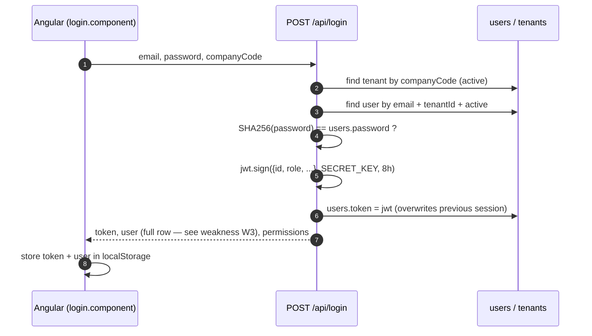
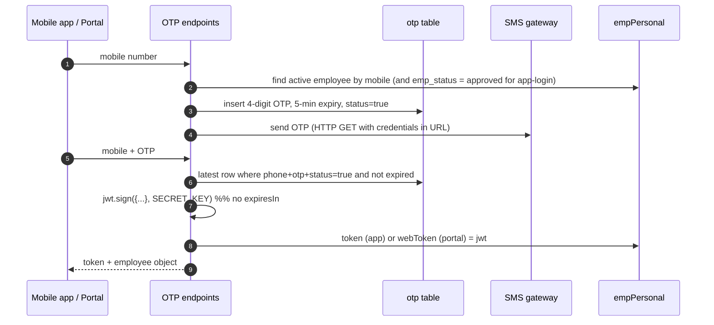

# GENS.Ai HRMS — Authentication & Security

> Scope: how identity, sessions, tenant/branch isolation and auditing work **today** in `e:\gens_frontend_backend`, and the security weaknesses found while reading the code.
> Method: evidence-based (code read only; nothing executed, no application code modified).
> Status labels: `IMPLEMENTED` · `PARTIALLY_IMPLEMENTED` · `DOCUMENTED_ONLY` · `NOT_FOUND` · `UNKNOWN` · `NEEDS_VERIFICATION`.
> **No secret values are reproduced in this document.** Where a secret exists in the repo, only its *location and kind* are named. Treat every item in §11 marked "committed" as already exposed and in need of rotation.
> Companion docs: `USER_ROLES_AND_PERMISSIONS.md` (who may do what), `API_CATALOG.md` (routes), `WORKFLOW_DOCUMENTATION.md`.

---

## 1. Executive summary

| Area | Status | One-line finding |
|---|---|---|
| Login (HR/admin web) | IMPLEMENTED | email + password + company code, SHA-256 (unsalted) compare, JWT (8 h) stored in DB row. |
| Login (SuperAdmin) | IMPLEMENTED | Same pattern; fixed system tenant; email-link password reset with a 15-minute JWT. |
| Login (Employee mobile app) | IMPLEMENTED | Mobile number + 4-digit SMS OTP; token never expires. Gated on `emp_status = approved`. |
| Login (Employee portal, web) | IMPLEMENTED | Same OTP flow, separate `webToken` slot. |
| Login (Interview panel) | IMPLEMENTED | Separate identity table, own guard `PanelUser`. |
| Login (Webcam / kiosk) | IMPLEMENTED | `WebcamAdmin` guard; 30-day token. |
| Session model | IMPLEMENTED | JWT signature **and** equality with the token stored in the DB row ("single active session per channel"). |
| Authorization (server) | PARTIALLY_IMPLEMENTED | Only *guards* (authentication + coarse identity type) and ad-hoc checks in a few handlers. No role/permission middleware. |
| Authorization (UI) | IMPLEMENTED (UI only) | `permission.service.ts` `DEFAULT_PERMISSIONS`; not enforced by the server. |
| Tenant isolation | PARTIALLY_IMPLEMENTED | Manual `where tenantId` in handlers; no global scope / RLS; several id-only lookups. |
| Branch isolation | PARTIALLY_IMPLEMENTED | Branch for `Admin` comes from a client-supplied `branchid` header, not validated against the user. |
| Audit log | PARTIALLY_IMPLEMENTED | `writeAudit` → `log` table → `POST /audit/list`; partial coverage. |
| Rate limiting / brute-force lockout | **NOT_FOUND** | No limiter, lockout, CAPTCHA or OTP attempt counter anywhere in `backend/`. |
| Security headers (e.g. helmet) | **NOT_FOUND** | Not used. |
| Password policy / MFA for admins | NOT_FOUND | No complexity rules found server-side; no MFA. |

Most serious items (details in §11): **unauthenticated password change (`/update-password`)**, **credentials and a Firebase service-account key committed to the repo**, **login responses that return password hashes and tokens**, **fixed/bypass OTPs**, **no rate limiting on 4-digit OTPs**, **tokens that never expire**, **CORS that reflects any origin with credentials**.

---

## 2. Technology used

| Concern | Implementation | Evidence |
|---|---|---|
| Framework | Express 5 (Node), routes auto-mounted under `/api` | `backend/server.js` |
| Token | `jsonwebtoken`, HS256 (library default), key from `process.env.SECRET_KEY` | `auth.js`, `login.js`, `employeePortal.js` |
| Password hash | `crypto-js` `SHA256(password)` hex, **no salt, no work factor** | `login.js`, `register.js`, `superadmin.js`, `panel_user_auth.js` |
| OTP delivery | SMS gateway via `Helper.sendSMS` | `helper/helper.js` |
| Mail | `nodemailer` (SuperAdmin reset only found) | `superadmin.js` |
| Push | Firebase Admin / FCM | `notification/notification.js` |
| Client token store | Browser `localStorage` | `frontend/src/app/**` (auth service / interceptor) |
| Transport | Whatever the reverse proxy provides — HTTPS enforcement not visible in repo (`NEEDS_VERIFICATION`) | — |

---

## 3. Identity stores and login mechanisms

| # | Surface | Identity table | Credential | Endpoint(s) | Guard afterwards |
|---|---|---|---|---|---|
| 1 | HR / Admin web | `users` (role `admin`/`hr`) | email + password + `companyCode` | `POST /login` | `Admin` |
| 2 | SuperAdmin web | `users` (role `superadmin`, system tenant `SUPERADMIN`) | email + password | `POST /superadmin/login` (+ forgot/reset) | `SuperAdmin` |
| 3 | Employee mobile app | `empPersonal` (`token`) | mobile + OTP | `POST /app-login` → `POST /verify-otp`; `POST /app-logout` (`AppAdmin`) | `AppAdmin` |
| 4 | Employee web portal | `empPersonal` (`webToken`) | mobile + OTP | `POST /employee-portal/send-otp` → `POST /employee-portal/verify-otp` | `AppAdmin` |
| 5a | Interview panel (OTP) | `interview_panel_users` | mobile (+ optional company code) + OTP | `POST /send-otp` → `POST /verify-otp-login` (`login.js`) | `PanelUser` |
| 5b | Interview panel (password) | `interview_panel_users` | company code + email + password | `POST /panel-user-login`, `POST /panel-user-logout` (`recruitment/panel_user_auth.js`) | `PanelUser` |
| 6 | Webcam / kiosk | `users` (any active user of the tenant — no role filter) | email + password + company code (30-day `webcamtoken`) | `POST /AIlogin` | `WebcamAdmin` |
| 7 | AI Face internal punch | none (service key) | `x-ai-service-key` header | `aiFace.js` | handler-level header compare |

> Other related routes in `routes/web.js`: `POST /logout` (`Admin`), `POST /update-password` (open — W1), `GET /check-token` (open — W6), `POST /company-register` (open). Four routes commented out in code (`team-leave-list`, `director-leave-list`, `get-app-applied-leaves`, `updateSalarySetUp`) are **not** active even though the catalog lists them (catalog 531 vs 527 active — see `USER_ROLES_AND_PERMISSIONS.md` §11).

### 3.1 HR/Admin web login (`login.js`)

Sequence (all responses are HTTP 200 with `status:false` for failures — the HTTP code is not a reliable success signal):

- Token lifetime: **8 h** (`IMPLEMENTED`).
- Per-user custom permissions (`user_permissions` table) are fetched and delivered at login; they drive UI only (`USER_ROLES_AND_PERMISSIONS.md` §4).
- Webcam/kiosk variant issues a **30-day** token in a separate column (`webcamtoken`) so kiosk and HR sessions don't evict each other.

### 3.2 SuperAdmin login and reset (`superadmin.js`)

- Login: look up active tenant `SUPERADMIN`, then user with `role = superadmin`; compare SHA-256; sign **8 h** JWT; store in `users.token`. Response returns only `id, name, email, role` (good — contrast with W3).
- Forgot password: generic message regardless of whether the email exists (good — no user enumeration); signs a reset JWT with `purpose: "password-reset"` and **15 min** expiry; emails a link built from `FRONTEND_URL`.
- Reset: verifies signature and `purpose`, sets new SHA-256 hash and clears `token` (kills active session). The reset JWT is **not** single-use (replayable within 15 min) — `NEEDS_VERIFICATION` that no used-token list exists (none found).
- A leaked reset JWT cannot be used as a session token because guards also require equality with `users.token`.

### 3.3 Employee OTP login (mobile app and portal)

Facts:
- OTP is **4 digits**, valid **5 minutes**, stored in plaintext in table `otp`.
- Mobile app login additionally requires `emp_status = approved` (employee rows still `pending` / `recommended` / `rejected` / `self_declined` cannot log in via the app). `IMPLEMENTED`.
- The OTP lookup is keyed on **phone + otp**, not on tenant; employees are resolved by mobile number alone. If the same number exists in two tenants the first match wins (`NEEDS_VERIFICATION` for real data).
- A previously issued, still-valid OTP is not invalidated when a new one is requested, and wrong guesses are not counted (see W5).
- `app` and `portal` tokens carry **no `expiresIn`** → valid until overwritten by a new login or cleared by logout (W6).
- Logout: `app-logout` clears `webToken` when called from web, otherwise clears `token` and `deviceToken`. `IMPLEMENTED`.

### 3.4 Interview panel (`panel_user_auth.js`, `panelAuth.js`)

- Separate identity table `interview_panel_users`; separate guard `PanelUser`.
- **OTP login** (`POST /send-otp` → `POST /verify-otp-login`, in `login.js`): the interviewer is looked up by mobile (restricted to a tenant when a company code is sent). The OTP is **a hard-coded constant for every interviewer** (the random generator is commented out) and the SMS carries that constant (W4). On successful verification the OTP row is marked used (`status=false`), so replay of the same row is blocked — but the constant is re-issued for the next request.
- **Password login** (`POST /panel-user-login`): requires `tenantId` (company code), `email`, `password` (all non-empty in the request). The check is `if (user.password && user.password !== hash) → reject`, i.e. when the stored password is `NULL` (allowed — `createInterviewPanelUser` stores `null` when no password is supplied) **any non-empty password is accepted** (W4).
- Token: 8 h JWT stored in the panel user's row, compared by `PanelUser`.

### 3.5 AI Face internal punch (`aiFace.js`)

- Not a user login. A trusted internal service calls the punch endpoint with an `x-ai-service-key` header; the controller compares it to an environment variable and, in non-production, falls back to a **built-in default** (value not reproduced — W11). `NEEDS_VERIFICATION` that `NODE_ENV=production` removes the fallback in deployment.

---

## 4. Guards (`middleware/auth.js`, `middleware/panelAuth.js`)

| Guard | Reads token from | Verifies | Loads | Extra enforcement | Populates |
|---|---|---|---|---|---|
| `Admin` | `Authorization: Bearer …` | `jwt.verify` with `SECRET_KEY` | `users` row by id | `users.token === presented`; role in `admin, hr, superadmin, employee`. **No check of user `status`, tenant status or subscription** | `req.users` (+ branch from `branchid` header) |
| `WebcamAdmin` | `Authorization` | same | `users` | compares `webcamtoken` | `req.users` |
| `SuperAdmin` | `Authorization` | same | `users` | `role === superadmin`; `token` equality | `req.users` |
| `AppAdmin` | `Authorization` | same | `empPersonal` | matches `token` (app) **or** `webToken` (portal) | `req.users` (employee-shaped) |
| `PanelUser` | `Authorization` | same | `interview_panel_users` | token equality | `req.panelUser` |

Behaviors worth knowing:
- Expired / mismatched / missing token → typically **HTTP 200** with `status: "expired"` (not 401). The Angular interceptor (`aut.interceptor.ts`) / `auth.guard.ts` keys off that.
- A guard proves *who you are*, never *what you may do*. For `Admin`, role `hr` and role `admin` pass equally; employee-level `manager` / `director` pass `AppAdmin` equally (`USER_ROLES_AND_PERMISSIONS.md` §3–§4).
- Guards are attached per route in the route files. Routes with **no** guard are listed in §6.

### 4.1 Single active session (DB token match)

- On every successful login the new JWT is written to the identity row, replacing the previous one.
- On every request, the guard rejects a validly signed JWT if it is not byte-equal to the stored one.
- Consequences:
  - Logging in from a second browser/device evicts the first (per channel: HR web, kiosk, app, portal are separate columns).
  - Server-side revocation is possible by nulling the column (done by logout and SuperAdmin reset). `IMPLEMENTED`.
  - Because non-expiring app/portal JWTs still need DB equality, stolen *old* tokens die at next login — but the *current* token never ages out (W6).
  - Concurrent usage by two legitimate users of one account is impossible by design.

---

## 5. Frontend security behavior

| Concern | Implementation | Label |
|---|---|---|
| Token storage | `localStorage` (readable by any XSS) | IMPLEMENTED (risk W8) |
| Route protection | `auth.guard.ts`, `permission.guard.ts`, `employee-portal.guard.ts` | IMPLEMENTED |
| Permission checks | `PermissionService.can()` — **unknown keys are allowed**; `PermissionGuard` defaults role to `hr` when unknown | IMPLEMENTED (UI-only, W2) |
| Token attach | HTTP interceptor adds `Authorization` | IMPLEMENTED |
| Expired handling | Interceptor reacts to `"expired"` responses and redirects to login | IMPLEMENTED |
| Role matrix storage | Edited matrix saved in `localStorage` (browser-local, not shared, not authoritative) | IMPLEMENTED |
| Chatbot | Client calls an **external** chat service (`chatApiUrl`) with `employee_id`, message, language and `X-Tenant-Id`; server source **NOT_FOUND** in repo | PARTIALLY_IMPLEMENTED / UNKNOWN |

---

## 6. Open (unauthenticated) endpoints

Routes registered without `Admin / SuperAdmin / AppAdmin / WebcamAdmin / PanelUser`. Some are open by necessity (login, OTP, registration). Others are not obviously intentional (`NEEDS_VERIFICATION` — confirm against `API_CATALOG.md` guard column and the route files):

| Group | Examples (kind) | Assessment |
|---|---|---|
| Login / OTP | `/login`, `/app-login`, OTP verify, panel login, `/superadmin/login`, forgot/reset | Necessary; needs throttling (W5). |
| Tenant self-registration | company/admin registration (`register.js`) | Public by design; abuse controls NOT_FOUND. |
| **Password change** | `/update-password` | **Not acceptable open** — W1. |
| Token probe | `/check-token` | Public lookup by token; returns an employee row (W7). |
| Public data | public job-post / careers style routes | Likely intentional (`UNKNOWN`). |
| Kiosk login | `/AIlogin` | Open by necessity; lacks throttling and returns the full user row (W3, W5). |
| Interview OTP | `/send-otp`, `/verify-otp-login` | Open by necessity; constant OTP (W4). |
| Utility / debug | `POST /generateDummyAttendance` (`routes/shift.js`, no guard) | Unguarded write that generates attendance rows (W9). |
| Static | `/upload`, `/uploads`, `/download/:file` | Public files; names are guessable for some artifacts (W10). |

---

## 7. Tenant and branch isolation

### 7.1 Tenant
- Source of truth: `req.users.tenantId` from the guard's DB load (not from client input). `IMPLEMENTED`.
- Enforcement: **each handler adds `where: { tenantId }` by hand**. There is no Sequelize default scope, no hook, no Postgres row-level security. `PARTIALLY_IMPLEMENTED`.
- Gaps: handlers that load a record by primary key only (e.g. `findByPk`, `findOne({ where: { id } })`) and then update it are cross-tenant risks if the id is guessable; UUID ids reduce but do not remove the risk. Specific instances were seen in leave/status-update style handlers (`NEEDS_VERIFICATION` per route — flagged W12).
- Employee leave application: `employeeId` is taken from the request body rather than only the token — an employee token could submit for another employee id in the same tenant (W12).
- Tenant is **not** part of OTP lookup (§3.3).

### 7.2 Branch
- For `Admin`, the active branch is read from the **client-supplied `branchid` header** and is not checked against branches the user is allowed to see (`PARTIALLY_IMPLEMENTED`; W12).
- `Helper.isBranchAccessRole`: employee-level `director`, and `manager` with explicit `branchIds`, get branch-wide visibility; other employees are limited to themselves / their reporting team.
- `POST /getDesignations` (`Admin`-guarded, `routes/designation.js`) interpolates the `branchid` header into a raw SQL fragment — **SQL-injection risk for any authenticated HR user** (W9). Other handlers use parameterised Sequelize queries (the norm).

---

## 8. Audit logging

| Item | Detail | Label |
|---|---|---|
| Writer | `backend/app/helper/auditLog.js` → `writeAudit(...)` inserts into model `log` | IMPLEMENTED |
| Reader | `POST /audit/list` (`audit.js`, `Admin` guard), tenant-scoped, capped list | IMPLEMENTED |
| Fields | actor, action, entity, tenant/branch, timestamp, metadata (exact columns — see model `log`) | IMPLEMENTED |
| Coverage | Only some controllers call `writeAudit`; login, failed login, password change, permission edits, payroll revert and most deletes are **not** consistently logged | PARTIALLY_IMPLEMENTED |
| Tamper protection | None (same DB, no hash chain, deletable by DB admin) | NOT_FOUND |
| Failed-login / security event log | NOT_FOUND | — |
| AI assistant action log | NOT_FOUND (see `EMPLOYEE_AI_ASSISTANT_CAPABILITIES.md`) | — |

Other logging: many handlers `console.log` request bodies and employee objects (PII leakage into process logs — W13). A request-size log line exists in `server.js`.

---

## 9. Rate limiting and abuse controls

`NOT_FOUND`. Searched `backend/` (excluding `node_modules`) for `express-rate-limit`, `rate-limit`, `helmet`, `slow-down`, lockout counters, CAPTCHA, and OTP attempt counters — none present; `package.json` lists none. Implications:
- 4-digit OTP (10 000 values) with a 5-minute window and no attempt counter is brute-forceable.
- SMS-send endpoints can be triggered repeatedly (cost and harassment vector).
- Password endpoints (HR login, panel login, `/update-password`) have no lockout.
- Mitigation may exist at the proxy / WAF — `UNKNOWN`.

---

## 10. Transport, CORS and server hardening

| Topic | Finding | Label |
|---|---|---|
| CORS | Origin callback reflects the **request origin** with `credentials: true` → any website can make credentialed browser calls | IMPLEMENTED (weak) — W8 |
| Body size | JSON/urlencoded limit **100 MB** | IMPLEMENTED (weak) |
| `helmet` / CSP / HSTS | NOT_FOUND in app (may be at proxy: UNKNOWN) | NOT_FOUND |
| Upload filters | `upload.js`: MIME prefix `image/` or `application/pdf` (client-declared), **no size limit**, original extension preserved; `excel_pdf_upload.js`: allow-list + 10 MB; `faceUpload.js`: images ≤ 5 MB; `logoUpload.js`: type+extension allow-list + size cap | PARTIALLY_IMPLEMENTED |
| Error handling | Many handlers return `err.message` to the client | IMPLEMENTED (info leak) |
| Static serving | `/upload`, `/uploads` served without auth; `/download/:file` | IMPLEMENTED (W10) |

---

## 11. Security weaknesses register

Severity is a documentation judgement (Critical / High / Medium / Low) based on code reading only; none were exploited. "Committed" = the secret is in the git working tree and must be treated as compromised.

| ID | Severity | Weakness | Where (no values) | Impact | Suggested direction |
|---|---|---|---|---|---|
| **W1** | Critical | **Unauthenticated password change.** `/update-password` accepts email + new password + company code and sets the password for the active user without verifying the old password, an OTP or a reset token (the old-password check is commented out). Response also issues fresh tokens. | `login.js` (`UpdatePassword`), `routes/web.js` line `POST /update-password` (no guard) | Account takeover of any HR/admin whose email + company code are known. | Require current password or signed one-time reset token; guard the route; log the event. |
| **W2** | High | **Authorization is mostly UI-only.** Role/permission matrix is client-side; the server has only identity guards plus a coarse `HR_ROLES` (admin/hr/superadmin) check inside the `expense`, `asset`, `project` and `performance` HR controllers. Elsewhere any authenticated `Admin`-guard token (roles incl. `employee`) or `AppAdmin` token can call the API directly. | `permission.service.ts`; `auth.js` | Privilege escalation by crafting requests (e.g. employee token calling employee-scoped writes for others; HR vs admin indistinguishable server-side). | Server-side permission middleware driven by `user_permissions` + role defaults. |
| **W3** | High | **Login responses leak sensitive fields:** full `users` row including password hash and tokens (HR login, `UpdatePassword`, `AIlogin`); `createInterviewPanelUser` returns the created row including hash. | `login.js`, `interview.js` | Hash exposure aids offline cracking (unsalted SHA-256); token exposure beyond need. | Return an allow-listed DTO. |
| **W4** | High | **Panel-user weak auth:** (a) interviewer OTP is a fixed constant for all interviewers; (b) `NULL` stored password makes `/panel-user-login` accept any non-empty password. | `login.js` (`interViewerlogin`), `recruitment/panel_user_auth.js`, `interview.js` | Anyone knowing a panel user's phone/email can obtain a panel session. | Random per-request OTP; reject login when no password is set. |
| **W5** | High | **No rate limit / attempt counter on OTP and password endpoints** (4-digit OTP). Earlier OTPs are not invalidated. | `login.js`, `employeePortal.js`, `panel_user_auth.js` | OTP brute force; SMS-cost abuse. | Per-phone/IP throttling, attempt counter, invalidate prior OTPs, longer OTP. |
| **W6** | High | **Non-expiring app and portal JWTs** and an unauthenticated `/check-token` that looks up an employee by token. | `login.js`, `employeePortal.js` | A stolen token is valid indefinitely (until the next login by the same user). | Add expiry + refresh, require guard on `/check-token`. |
| **W7** | High | **Hardcoded credentials in source**: SMS gateway user/password/entity/template identifiers are literals inside `Helper.sendSMS`; request is sent over plain HTTP with the credentials in the query string. **Committed.** | `helper/helper.js` | Gateway account abuse, credentials visible in history/logs/proxies. | Move to env; rotate; use HTTPS. |
| **W8** | High | **Firebase service-account private keys committed** (three files: two under `backend/app/notification/`, one at `frontend/notification.json`) — all type `service_account` with `private_key` fields. Also tracked: `frontend/src/environments/environment*.ts` (contain service URLs and Firebase *web* config; the web config itself is public-by-design) despite ignore rules intended to exclude them. | tracked files listed | Full FCM/Firebase admin access for the project; any clone of the repo has it. | Revoke/rotate keys; remove from history; load from secret store. |
| **W9** | High | **SQL injection** (authenticated): `/getDesignations` concatenates the `branchid` header into raw SQL. **Unguarded write**: `POST /generateDummyAttendance`. | `routes/designation.js` → designation controller; `routes/shift.js` → `controller/tenant/shift.js` | Data disclosure/modification. | Parameterise; guard or remove. |
| **W10** | Medium | **Public static files and predictable names**: `/upload`, `/uploads` and `/download/:file` unauthenticated; payslip files use predictable naming; `upload.js` has no size limit and trusts client MIME. Uploaded files are also tracked in git. | `server.js`, `middleware/upload.js` | Document disclosure (payslips, IDs); storage DoS. | Signed/authorised downloads; random names; size caps. |
| **W11** | Medium | **Test/bypass values in code:** a hardcoded test mobile number triggers a fixed OTP (app login skips SMS; portal accepts the fixed OTP); AI-Face service key has a built-in default; `helper.js` (~line 61) reads `process.env.SECRET_KEY` with a literal **fallback string**, and `helper/aiFaceCrypto.js` does the same for `AI_FACE_SECRET`. Values are deliberately not reproduced here. | `login.js` (`Applogin`), `employeePortal.js`, `aiFace.js`, `helper.js`, `aiFaceCrypto.js` | Backdoor login for that number if enabled in production; forgeable tokens if the fallback is ever used. | Remove or gate on `NODE_ENV !== production`; fail fast if `SECRET_KEY` is missing. |
| **W12** | Medium | **Weak tenant/branch/object scoping:** id-only lookups in some updates; `branchid` header trusted; leave `employeeId` from body; payroll/expense amounts client-trusted in some flows. | various controllers | Cross-tenant/IDOR and tampering risks (route-specific, `NEEDS_VERIFICATION`). | Always add `tenantId` and ownership to `where`; derive employee from token; recompute amounts server-side. |
| **W13** | Medium | **Unsalted SHA-256 password hashing** everywhere; **PII in `console.log`**; error messages returned verbatim. | `login.js`, `register.js`, many controllers | Fast offline cracking; log leakage. | bcrypt/argon2 with migration on next login; log scrubbing. |
| **W14** | Medium | **CORS reflects any origin with credentials**; 100 MB body limit; no security headers. | `server.js` | Cross-site credentialed calls; request-size DoS. | Origin allow-list; lower limits; helmet. |
| **W16** | Medium | **Guards never re-check account state.** `Admin`, `AppAdmin`, `PanelUser` load the row by id and compare the token, but do not check `status`/active flag, `emp_status`, tenant status or subscription. A deactivated/rejected/relieved account keeps working until its stored token is replaced or cleared (whether `deleteEmp`/deactivation clears tokens: `NEEDS_VERIFICATION`). | `middleware/auth.js`, `panelAuth.js` | Offboarded staff retain API access; suspended tenants not blocked at the API. | Check status/tenant/subscription in guards; null tokens on deactivation. |
| **W17** | Low | **Leave status endpoint lacks tenant scope and approver authority.** `/update-apply-leaves-status` loads the leave by id only and accepts any status string from any `AppAdmin` token (blocks only `teamLeader`/`project_manager` from `approved`); `/update-status` (regularization) does not whitelist status. | `appApi.js` | Cross-tenant IDOR (needs a leave id), unauthorised approval, arbitrary status values. | Scope by tenant + reporting line; whitelist statuses. |
| **W18** | Low | **Backup route file is mounted.** `routes/app_6_10_2026.js` is auto-loaded by `readdirSync`; all 40 of its routes duplicate `routes/app.js` and are shadowed (first registration wins), but any future divergence goes live silently. A backup controller `appApi_10_6_2026.js` also exists. | `server.js`, `routes/` | Hygiene / drift. | Remove backups from `routes/`. |
| **W15** | Low | Auth failures return HTTP 200; reset JWT replayable for 15 min; single-session means shared accounts cannot work. | guards, `superadmin.js` | Monitoring blind spots; minor. | Use 401/403; one-time reset tokens. |

### 11.1 Rotation checklist (action items, not values)
1. Revoke and re-issue the Firebase service-account keys referenced in W8; delete from git history.
2. Rotate the SMS gateway credentials (W7).
3. Rotate `SECRET_KEY` (this logs out every session) after fixing W1/W6.
4. Rotate the AI-Face service key; confirm production does not use the default (W11).
5. Remove the test mobile bypass or confirm it is disabled in production (W11) — `NEEDS_VERIFICATION` of the deployed environment.

---

## 12. What this means for the AI assistant (design constraints)

- The assistant must send the **end user's own token** and never a service token; the server cannot yet distinguish roles beyond identity type, so the assistant layer must enforce role checks itself (`USER_ROLES_AND_PERMISSIONS.md` §10).
- Because there is no server-side throttling, the assistant should impose its own rate limits and never expose OTP flows.
- Never echo password hashes, tokens or raw rows returned by APIs (W3) to the chat UI — project to an allow-list.
- Treat `"expired"` / `status:false` responses (HTTP 200) as failures.
- Writes must have confirmation and an audit entry created by the assistant (no audit exists for assistant actions — NOT_FOUND).

---

## 13. Open items / `NEEDS_VERIFICATION`

1. Production reverse-proxy settings: HTTPS enforcement, HSTS, rate limiting, WAF.
2. Whether `NODE_ENV=production` is set (affects the AI-Face default key and CORS/dev paths).
3. Whether the test-mobile OTP bypass is reachable in production.
4. Per-route confirmation of tenant scoping for each id-only lookup noted in W12.
5. Exact guard attachment of routes in §6 (re-check `API_CATALOG.md` guard column; four commented-out routes excluded).
6. Whether the external Python AI/ATS services authenticate callers (source `NOT_FOUND` in repo).
7. Data-retention and DPDP/GDPR compliance posture — `UNKNOWN`.
