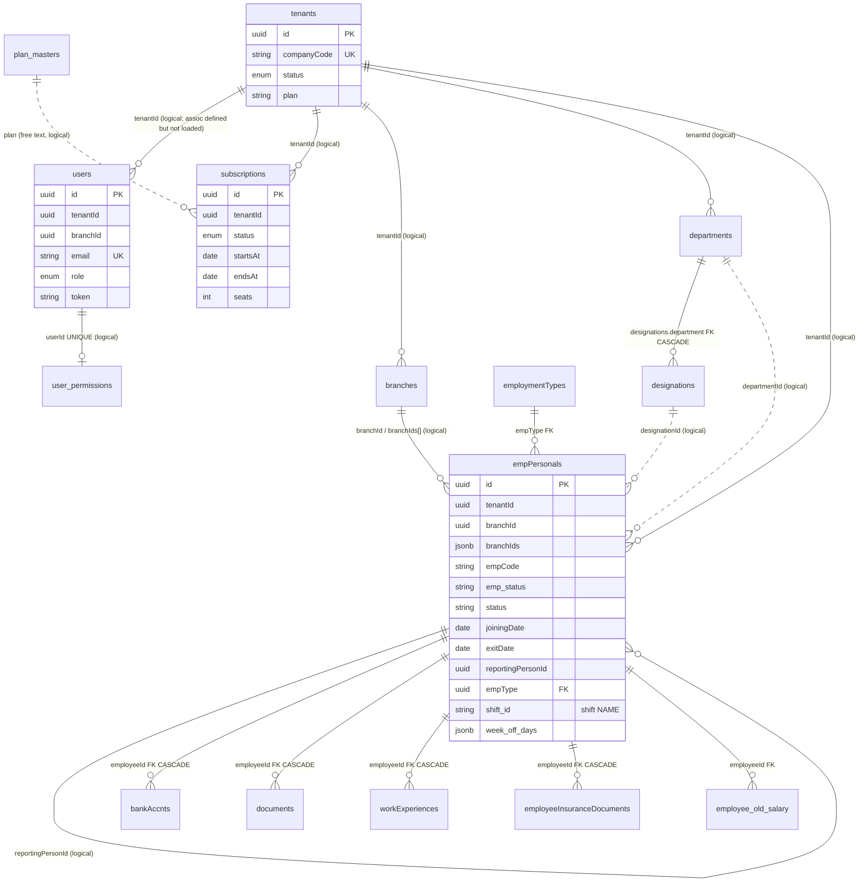
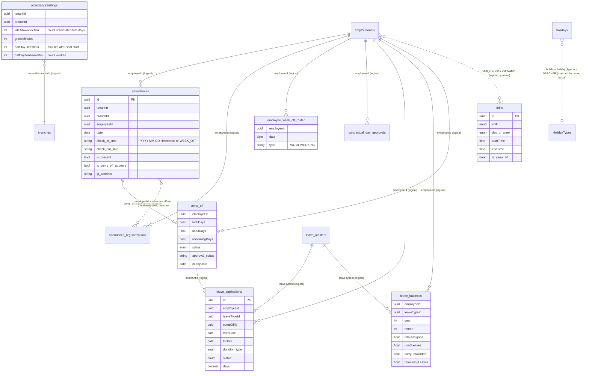
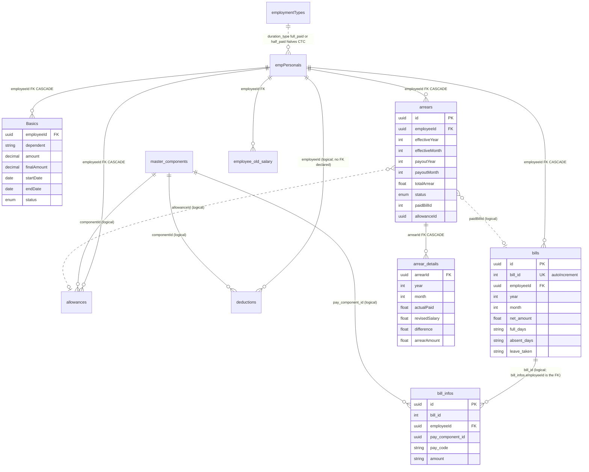
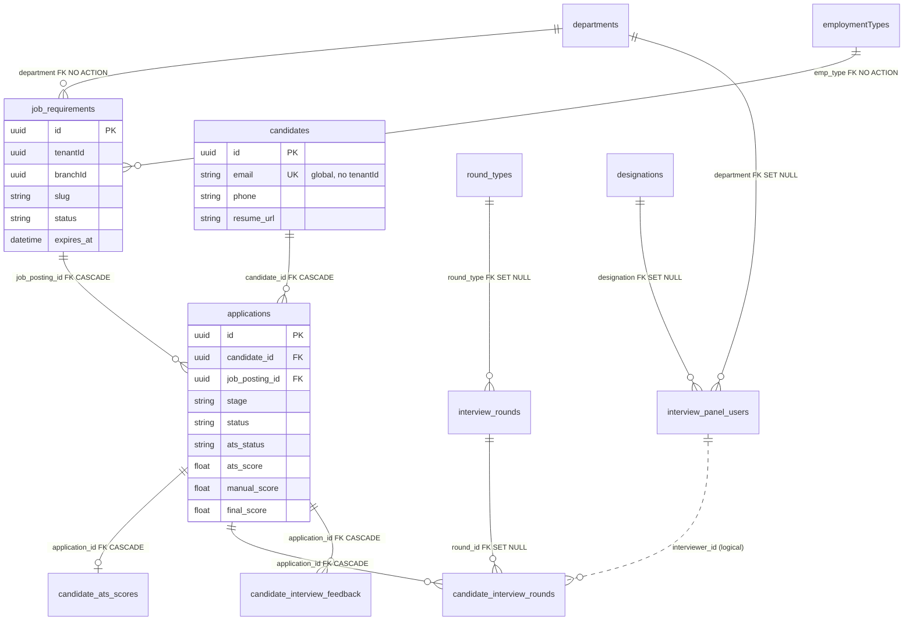
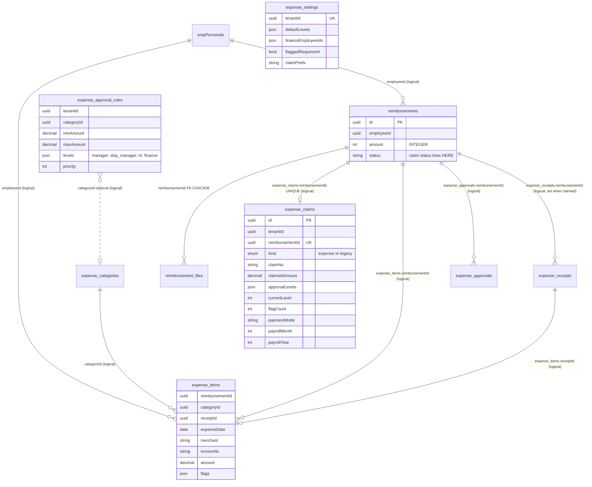
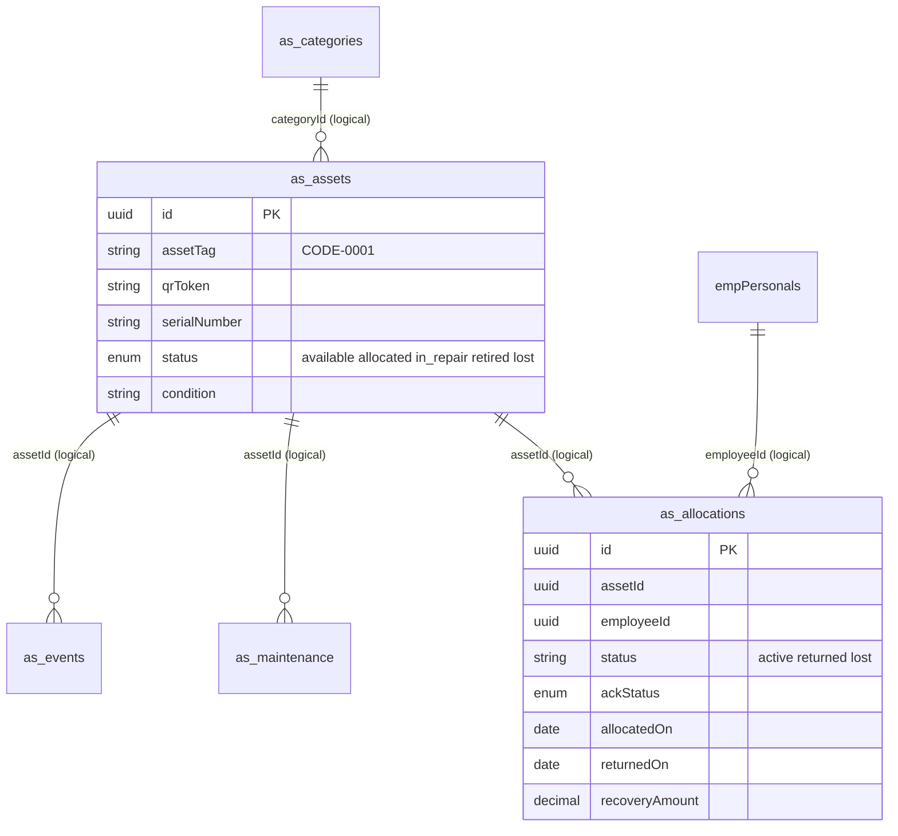
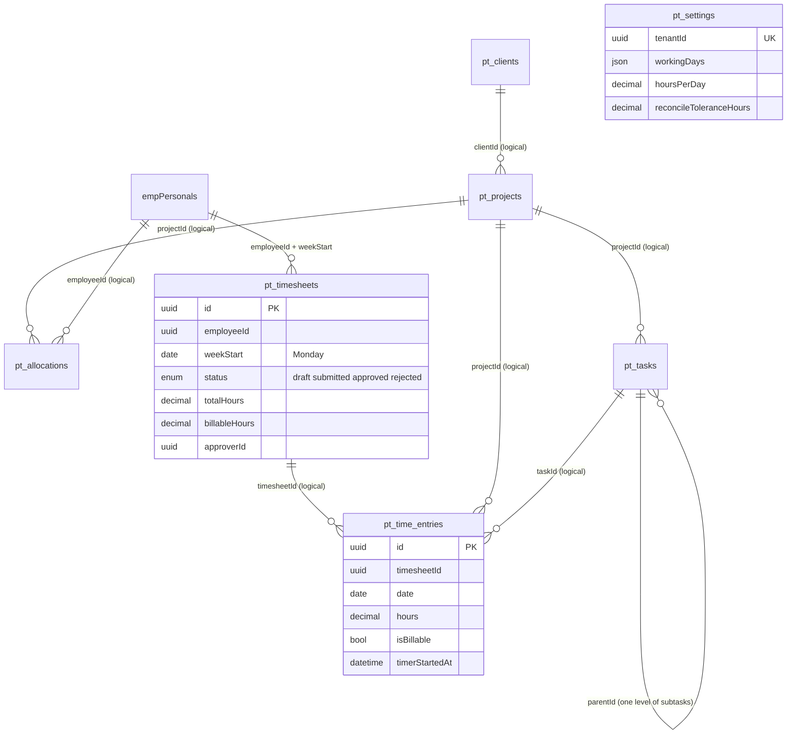
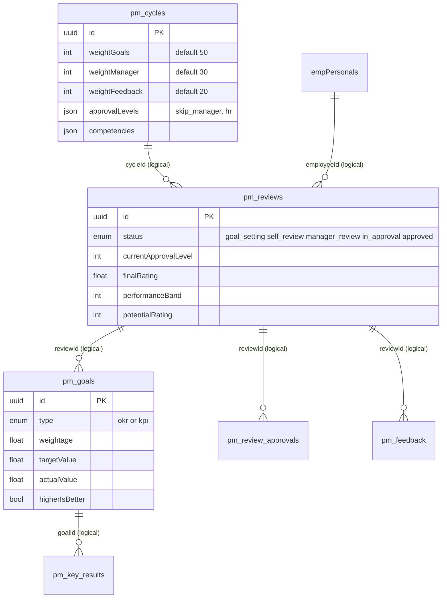
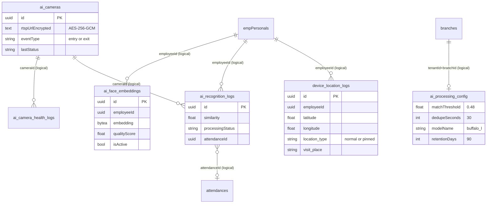

# GENS.Ai HRMS — Database Schema Reference

> Scope: the Sequelize models under `backend/app/models/` (PostgreSQL), as they exist in the repository.
> Method: every model file was **loaded programmatically** against a stubbed (non-connected) Sequelize instance to read the real table names, columns, types, enums, defaults, unique flags and `references:`. No real database was touched and no application code was modified. The raw column dictionary is reproduced in [Appendix A](#appendix-a--column-dictionary-generated-from-model-files).
> Related docs in this folder: `SYSTEM_OVERVIEW.md`, `API_CATALOG.md`, `AUTHENTICATION_AND_SECURITY.md`, `USER_ROLES_AND_PERMISSIONS.md`, `COMPLETE_MODULE_CATALOG.md`, `BUSINESS_RULES.md`.

Status labels used: **IMPLEMENTED** (found in code), **PARTIALLY_IMPLEMENTED**, **DOCUMENTED_ONLY** (only in docs/DBML), **NOT_FOUND**, **UNKNOWN**, **NEEDS_VERIFICATION** (cannot be proven from the repository alone — usually "what the live DB actually contains").

---

## 1. Headline facts and caveats

| # | Fact | Evidence | Status |
|---|---|---|---|
| 1 | 102 files in `backend/app/models`; **99 are Sequelize models** (99 tables). The other 3 are `index.js`, `associations.js` and `leaveLedger.js` (0 bytes). | `models/` listing; programmatic load | IMPLEMENTED |
| 2 | **`models/index.js` only loads the recruitment models** (`JobRequirement`, `Department`, `Candidate`, `CandidateAtsScore`, `CandidateInterviewRound`, `CandidateInterviewFeedback`, `Application`) and calls `associate` on them. `server.js` does `require('./app/models/index')`. | `backend/app/models/index.js`, `backend/server.js` | IMPLEMENTED |
| 3 | Almost **no other Sequelize associations exist** (`hasMany/belongsTo`). Exceptions: `models/application.js` (recruitment), `candidate_interview_round.js`, `interview_panel_user.js`, `interview_round.js`, `job_requirement.js`, `tenant.js` and `users.js` (define `associate`, but are not wired through `index.js`), and `associations.js` (Reimbursement ↔ ReimbursementFile; not required by `server.js`). Controllers therefore join **manually** (`findAll` + in-memory maps). | grep of `hasMany|belongsTo|hasOne` in `models/` | IMPLEMENTED |
| 4 | **Database-level foreign keys** exist only where a model declares `references:` (list in §4). Whether the live database really has them is **NEEDS_VERIFICATION** (tables are created by `sync`/scripts, and `sync({alter:false})` does not add FKs to existing tables). | programmatic dump | NEEDS_VERIFICATION |
| 5 | **Multi-tenancy** = shared schema, `tenantId UUID` column on 86 of 99 tables, enforced only by hand-written `where: { tenantId }` in controllers. No global scope, no row-level security. | `connection.js` has no `define`/hooks | IMPLEMENTED |
| 6 | **Branch scoping**: `branchId UUID` exists on 62 tables that also have `tenantId`. `empPersonals.branchIds` (JSONB) lets one employee access several branches (directors/managers). | dump | IMPLEMENTED |
| 7 | Table names are Sequelize **default-pluralised** unless a model sets `tableName`/`freezeTableName` (`connection.js` sets no `define` options). So names are a **mix** of camelCase (`empPersonals`, `bankAccnts`, `Basics`, `HolidayTypes`, `attendanceSettings`) and snake_case (`leave_masters`, `pm_cycles`). Quoted identifiers are required in raw SQL (confirmed by `backend/scripts/sql/employee_week_off.sql`, which uses `"empPersonals"`). | dump; `scripts/sql/*.sql` | IMPLEMENTED |
| 8 | **Tables are created by several mechanisms**, so a fresh database needs more than "start the server": (a) `server.js` explicit `.sync({alter:false})` for a list of newer models (see §2.3), (b) model files that sync/alter themselves on `require`, (c) one-off scripts under `backend/scripts/`, (d) tables whose creation path is **not visible** (e.g. `empPersonals`, `attendances`, `bills` – presumably created by an earlier `sync` or manual migration). There is **no migration framework** (no `sequelize-cli`, no `migrations/` folder). | `server.js`, `scripts/`, grep | PARTIALLY_IMPLEMENTED |
| 9 | `gens_final_er.dbml` (and 3 smaller DBML files) is **out of date**: 61 tables, snake_case plural names, and **missing** every newer module (see §9). | DBML files | DOCUMENTED_ONLY |
| 10 | Passwords/tokens live in plain columns: `users.password` is SHA-256 hex (not salted), `interview_panel_users.password`/`token`, `users.token`/`webcamtoken`, `empPersonals.token`/`webToken`/`deviceToken`. | model dump | IMPLEMENTED |

---

## 2. How the schema is created and mutated

### 2.1 Connection (`backend/app/connection/connection.js`)
Sequelize `postgres` dialect, pool `max: 10`, `timezone: '+05:30'`, schema from env `DB_SCHEMA`, **no** `define:` options. Consequences: default timestamps (`createdAt`/`updatedAt`) are on for every model unless the model overrides it; default table-name pluralisation applies.

### 2.2 Models that change the DB when merely `require`d (side effects on load)
| Model file | Side effect |
|---|---|
| `branch.js` | ensures column `range` (INT, geofence metres) exists |
| `empPersonal.js` | ensures `branchIds` (JSONB), `profileImageHash`, `week_off_days` (JSONB) |
| `tenant.js` | ensures logo/letterhead/handbook/insurance columns |
| `appConfig.js`, `appConfigField.js`, `appConfigValue.js` | call `.sync()` and ensure a unique index |

### 2.3 `server.js` explicit `.sync({ alter: false })` list
`UserPermission`, `DocumentTemplate`, `GeneratedDocument`, the 6 `pm_*` models, the 7 `expense_*` models, the 7 `pt_*` models, the 5 `as_*` models and `employeeWeekOffRoster`. `alter:false` means: create if missing, **never** alter existing columns.

### 2.4 Scripts and SQL (`backend/scripts/`)
`create-ai-face-tables.js` (the 5 `ai_*` models with `alter:true`, plus widening `attendances.check_in_img/check_out_img` to VARCHAR(255)); `create-arrear-tables.js` and `sql/arrear_tables.sql`; `sql/employee_week_off.sql` (adds `empPersonals.week_off_days`, creates `employee_week_off_roster` with a `CHECK (type IN ('WO','WORKING'))` and a unique index `(tenantId, employeeId, date)`); `seed-countries.js`; `copy-master-data.js`; `bulk-set-salaries-by-designation.js`; `reset-password.js`; `backend/seeders/init-default-tenant.js`.
> **AI-face tables are not synced by `server.js`.** If `create-ai-face-tables.js` has not been run, the AI-face endpoints will fail — NEEDS_VERIFICATION for any given environment.

---

## 3. Tenant / branch / data-isolation patterns

| Pattern | Tables | Notes |
|---|---|---|
| `tenantId` **and** `branchId` | 62 tables (attendance, leave, payroll, employee children, recruitment `job_requirements`, `pm_cycles`, `pm_goals`, `pm_reviews`, `pt_projects`, `pt_timesheets`, `as_assets`, `expense_claims`'s siblings …) | Branch comes from `req.users.branchId` (JWT/guard) — on web login it is read from the **client-supplied `branchid` request header** and is not validated against the user's branches (`middleware/auth.js`). |
| `tenantId` only | `ai_camera_health_logs, app_config, as_allocations, as_categories, as_events, as_maintenance, branches, expense_approvals, expense_approval_rules, expense_categories, expense_claims, expense_items, expense_receipts, expense_settings, pm_feedback, pm_key_results, pm_review_approvals, pt_allocations, pt_clients, pt_settings, pt_tasks, pt_time_entries, subscriptions, user_permissions` | Company-wide masters, or children whose branch is derived from the parent. |
| **No `tenantId`** | `tenants` (it *is* the tenant), `plan_masters`, `landing_site_contents`, `landing_contact_submissions`, `otps`, `app_config_fields`, `countries`, `states`, `cities`, `pin_code_master` (global/reference data); **`candidates`, `applications`** (recruitment — tenant only reachable through `job_requirements.tenantId`); **`employee_old_salary`** | `candidates.email` is globally `UNIQUE` and the public application endpoint **updates an existing candidate row by email regardless of tenant** (`controller/recruitment/candidate.js` ~500–540) → cross-tenant overwrite of candidate profile data is possible (NEEDS_VERIFICATION of impact). |

Other conventions: UUID primary keys (`id UUID`) almost everywhere, generated by `DataTypes.UUIDV4`; audit columns `createdBy`/`updatedBy` (UUID, no FK) on most business tables; soft state through `status` ENUM/strings (`active|inactive`) rather than `deletedAt` — only `log` is `paranoid`. Date-like values are sometimes stored as strings (see §8).

---

## 4. Database-level foreign keys declared in models (`references:`)

| Child column | Parent | `onDelete` |
|---|---|---|
| `allowances.employeeId`, `Basics.employeeId`, `bills.employeeId`, `bill_infos.employeeId`, `bankAccnts.employeeId`, `documents.employeeId`, `workExperiences.employeeId`, `employeeInsuranceDocuments.employeeId`, `arrears.employeeId` | `empPersonals.id` | CASCADE |
| `employee_old_salary.employeeId` | `empPersonals.id` | (none) |
| `empPersonals.empType` | `employmentTypes.id` | (none) |
| `arrear_details.arrearId` | `arrears.id` | CASCADE |
| `designations.department` | `departments.id` | CASCADE |
| `job_requirements.department` | `departments.id` | NO ACTION |
| `job_requirements.emp_type` | `employmentTypes.id` | NO ACTION |
| `interview_panel_users.department` / `.designation` | `departments.id` / `designations.id` | SET NULL |
| `interview_rounds.round_type` | `round_types.id` | SET NULL |
| `applications.candidate_id` | `candidates.id` | CASCADE |
| `applications.job_posting_id` | `job_requirements.id` | CASCADE |
| `candidate_ats_scores.application_id`, `candidate_interview_feedback.application_id`, `candidate_interview_rounds.application_id` | `applications.id` | CASCADE |
| `candidate_interview_rounds.round_id` | `interview_rounds.id` | SET NULL |
| `reimbursement_files.reimbursementId` | `reimbursements.id` | CASCADE |
| `cities.state_id` | `states.id` | (none) |

Everything else in the ER diagrams below (employee ↔ attendance, leave, comp-off, `pm_*`, `pt_*`, `as_*`, `expense_*`, `ai_*`, `tenantId → tenants`, `branchId → branches`) is a **logical relationship only** (a UUID column with no `references:`). The diagrams mark logical links with a dotted style in the notes and a `%% logical` comment.

Behavioural consequence: `deleteEmp` (`controller/tenant/empPersonal.js`) hard-deletes the employee; DB cascade (if the FKs exist) removes bills/allowances/etc., and the controller also manually deletes attendance, bills, bill_info, leave_applications, Basic, Allowance, bankAccnt, document, leave_balance **without a transaction**. Rows in `deductions`, `comp_off`, `as_allocations`, `pm_*`, `pt_*`, `expense_*`, `ai_face_embeddings`, `device_location_logs`, `arrears`(cascade only if FK), `contractual_day_approvals`, `employee_week_off_roster` are **not** removed by the controller → orphans (NEEDS_VERIFICATION per table).

---

## 5. Module → table map (99 tables)

| Module | Tables |
|---|---|
| M01 Auth / tenancy / onboarding | `tenants`, `users`, `subscriptions`, `plan_masters`, `otps`, `user_permissions` |
| M02 Organisation masters | `branches`, `departments`, `designations`, `employmentTypes`, `prefixes`, `currencies`, `skills`, `countries`, `states`, `cities`, `pin_code_master`, `HolidayTypes`, `documentTypes`, `salary_orders` |
| M03 Company settings | `app_config`, `app_config_fields`, `app_config_values` (+ `user_permissions`, brand/letterhead columns on `tenants`) |
| M04 Employee | `empPersonals`, `workExperiences`, `documents`, `employeeInsuranceDocuments`, `bankAccnts`, `employee_old_salary` |
| M05 Attendance | `attendances`, `attendanceSettings`, `attendance_regularizations`, `shifts`, `holidays`, `employee_week_off_roster`, `contractual_day_approvals` |
| M06 AI face | `ai_cameras`, `ai_camera_health_logs`, `ai_face_embeddings`, `ai_processing_config`, `ai_recognition_logs` |
| M07 Location tracking | `device_location_logs` |
| M08 Leave | `leave_masters`, `leave_applications`, `leave_balances`, `comp_off` (`leaveLedger.js` is empty — the "ledger" screen is derived, not stored) |
| M09 Payroll | `master_components`, `Basics`, `allowances`, `deductions`, `bills`, `bill_infos`, `arrears`, `arrear_details` (+ `employee_old_salary`, `salary_orders`, `salarydocs`) |
| M10 Reports | no dedicated tables (reads attendance/bills/emp) |
| M11 Reimbursement | `reimbursements`, `reimbursement_files` (shared with expense) |
| M12 Expense | `expense_categories`, `expense_approval_rules`, `expense_settings`, `expense_receipts`, `expense_items`, `expense_claims`, `expense_approvals` |
| M13 Performance | `pm_cycles`, `pm_goals`, `pm_key_results`, `pm_reviews`, `pm_review_approvals`, `pm_feedback` |
| M14 Projects / timesheets | `pt_clients`, `pt_projects`, `pt_allocations`, `pt_tasks`, `pt_timesheets`, `pt_time_entries`, `pt_settings` |
| M15 Assets | `as_categories`, `as_assets`, `as_allocations`, `as_maintenance`, `as_events` |
| M16 Recruitment | `job_requirements`, `candidates`, `applications`, `candidate_ats_scores`, `candidate_interview_rounds`, `candidate_interview_feedback`, `interview_rounds`, `round_types`, `interview_panel_users`, `offer_letters` |
| M17 HR documents / letters | `letter_data`, `document_templates`, `generated_documents`, `salarydocs` |
| M18 Dashboard / notifications / audit | `log` (audit), `notification_reads` |
| M19 Super admin / public site | `landing_site_contents`, `landing_contact_submissions`, `plan_masters`, `subscriptions`, `tenants` |

---

## 6. Key columns that carry business meaning (read these before the appendix)

### 6.1 Tenancy and identity
- `tenants` — `companyCode` (UNIQUE, the "tenant id" typed at login), `status` (`active|inactive`), `plan` (free-text, default `basic`; **not** an FK to `plan_masters`), `brandColors` JSONB, file columns `image`, `imageDark`, `letterhead`, `handbook`, `insurancePolicy`.
- `users` — admin/HR/superadmin login accounts. `email` is **globally UNIQUE** (not per tenant). `role` ENUM `admin|hr|employee|superadmin`. Two session tokens stored on the row: `token` (8 h JWT) and `webcamtoken` (30 d JWT) → one active session per user.
- `empPersonals` — the employee master (very wide). Notable: `empCode`, `emp_status` (default `pending`; `approved|rejected` after review), `status` (`active|inactive`), `joiningDate`, `exitDate`, `reportingPersonId` (self-reference, logical), `empType` (FK → `employmentTypes`), `designationId`/`departmentId` (logical), **`shift_id` is a VARCHAR holding the shift *name*, not an id**, `week_off_days` JSONB (fixed weekday names), `branchId` + `branchIds` JSONB, `role` (free-text VARCHAR: `manager`, `director`, `teamLeader`, `project_manager`, `recruiter`, … used by the mobile/portal APIs; **not** the same field as `users.role`), mobile auth (`token`, `webToken`, `deviceId`, `deviceToken`), `isLocation` (location-tracking employee; also bypasses geofence), `isofflineAtt` (mobile attendance allowed), `isofflineAllTimeAtt`, `isContractual`, `hourlyRate`.
- `subscriptions` — `plan`, `status` (`active|expired|cancelled`), `startsAt`, `endsAt`, `seats` (nullable = unlimited), `metadata`. **Company self-registration does not create a subscription row** (`controller/auth/register.js` creates only `tenants` + one `users` admin) → seat enforcement only applies once a super admin runs `upsertSubscription`.
- `plan_masters` — `name` UQ, `code` UQ, `price`, `billingCycle` (`monthly|yearly|one_time`), `durationDays`, `maxUsers`, `metadata` (Razorpay plan id lives in `metadata`).

### 6.2 Attendance
- `attendances` — one row per (employee, date, tenant, branch). `check_in_time`/`check_out_time` are **STRING(50)** in the form `YYYY-MM-DD HH:mm:ss`, or the markers `WEEK_OFF`/`WO` written by uploads; `is_present`, `is_comp_off_approve`, `Inlatitude/Inlongitude/Outlatitude/Outlongitude` (**VARCHAR(50)**, not numbers), `ip_address` (NOT NULL), `shift_id`, `empType`, `date` (DATE), `month`, `year`, image columns `check_in_img`/`check_out_img` (VARCHAR(50) in the model; `create-ai-face-tables.js` widens them to 255 in DBs where it was run).
- `attendanceSettings` — per tenant+branch: `lateAllowanceMin` (default 3 — **a count of tolerated late days**, despite the name), `graceMinutes` (15), `halfDayThreshold` (45, minutes after shift start), `halfdayToAbsentMin` (4, **hours** worked below which the day is absent).
- `shifts` — **one row per shift-name per weekday** (`shift` ENUM `Day|Night|Afternoon|General`, `day_of_week`, `startTime`, `endTime`, `workingHours`, `is_week_off`).
- `employee_week_off_roster` — date-level override: `type` `WO|WORKING`.
- `attendance_regularizations` — `status` `pending|approved|rejected`, stores `originalCheckIn/Out`, `wasNewAttendance` so an approval can be reverted.
- `contractual_day_approvals` — `pending|approved|rejected`, `totalHours`, `requiredHours` (see BUSINESS_RULES for the unused-in-payroll caveat).

### 6.3 Leave
- `leave_masters` — `leaveCode`, `isPaid`, `allowedPerYear`, `carryForward`, `maxCarryForward`, `enCashable`, `genderRestriction` (`male|female|all`), `requiresApproval`, `applyBeforeDays`.
- `leave_applications` — `duration_type` (`full|first_half|second_half|short_leave`), `status` (`pending|recommended|approved|rejected|escalate|self_declined`), `days DECIMAL(4,1)`, `compOffId`, `approverId`, `recommendedId`, `canceledId`.
- `leave_balances` — **monthly** rows: `(employeeId, leaveTypeId, year, month)` with `totalAssigned`, `usedLeaves`, `carryForwarded`, `remainingLeaves`, `prevremainingLeaves`, `prevusedLeaves` (the `prev*` pair lets payroll revert restore the previous month).
- `comp_off` (table name literally `comp_off`) — `totalDays`, `usedDays`, `remainingDays`, `status` (`active|expired|used`), `approval_status` (**model default `"approved"`**), `earnedDate`, `expiryDate`.

### 6.4 Payroll
- `master_components` — salary component master: `value_type` (`fixed|percentage|basic_dependent|is_special`), `component_type` (`payable|deductible|reimbursable`).
- `Basics` — **the Sequelize model is named `Basic`, so the physical table is `Basics`**: CTC/basic rows (`dependent`, `amount`, `finalAmount`, `startDate`, `endDate`, `status`). The *annual CTC* is read from here by payroll.
- `allowances` / `deductions` — per-employee component rows with `type`, `typeValue`, `finalAmount`, `startDate`/`endDate`, `status` (versioned by date; appraisal closes old rows and inserts new ones).
- `bills` (payslip header) — `bill_id` INTEGER **autoIncrement + UNIQUE** (a human-visible sequence), `net_amount` FLOAT, and counters stored as **STRING** (`full_days`, `absent_days`, `leave_taken`, `allowed_leave`, `half_day`, `late_attendance`). `bill_infos` — line items (`pay_component_id`, `pay_code`, `amount` **STRING**).
- `arrears` / `arrear_details` — `status` (`draft|pending|approved|rejected|paid`), effective/implementation/payout year-month triplets, `paidBillId`, `allowanceId`; details hold per-month `actualPaid`, `revisedSalary`, `difference`, `arrearAmount`, `componentBreakup` JSONB.

### 6.5 Expense / reimbursement
`reimbursements` is the **header** for both the legacy single-step reimbursement and the new expense claim (`expense_claims.reimbursementId` UNIQUE links them; `expense_claims.kind` `expense|legacy`). `reimbursements.amount` is **INTEGER** whereas `expense_claims.claimedAmount` is DECIMAL (rounding). `expense_approval_rules.levels` is JSON (ordered list of `manager|skip_manager|hr|finance`).

### 6.6 Performance / projects / assets
- `pm_reviews.status`: `goal_setting → self_review → manager_review → in_approval → approved`.
- `pt_timesheets` is **one row per employee per ISO week** (`weekStart` = Monday): `draft|submitted|approved|rejected`; `pt_time_entries` rows hang off it (`timerStartedAt` non-null = running timer).
- `as_assets.status`: `available|allocated|in_repair|retired|lost`; `as_allocations.ackStatus`: `not_required|pending|acknowledged|disputed`; `as_events` is an append-only history; `as_assets.qrToken` is a random 16-byte hex used by QR labels.

### 6.7 Recruitment
`candidates` (global, `email` UNIQUE, no tenant) → `applications` (stage/status strings; `ats_status` `queued|completed|failed`; `ats_score`, `manual_score`, `final_score`) → `candidate_ats_scores`, `candidate_interview_rounds`, `candidate_interview_feedback`. `job_requirements` carries tenant/branch, slug, publish token/URL and `expires_at`. `interview_panel_users` are external interviewers with their own `password`/`token` columns (guard `PanelUser`).

---

## 7. Entity-relationship diagrams

Legend: **solid FK** = declared with `references:` in a model file; relationships drawn from "logical" columns are annotated `%% logical` and are not enforced by the model layer. Column lists are trimmed to the most relevant fields and Mermaid types are simplified (e.g. `float` may stand for DECIMAL/FLOAT) — the exact types are in Appendix A.

### 7.1 Tenant, organisation and employee

### 7.2 Attendance, shifts, week-off and leave

### 7.3 Payroll

`bills`/`bill_infos` link by `bill_info.bill_id` ↔ `bills.bill_id` in code (the column on `bill_infos` is a plain INTEGER); the only declared FK on `bill_infos` is `employeeId` (NEEDS_VERIFICATION in the live DB).

### 7.4 Recruitment (the only cluster with Sequelize associations)

Notes: `offer_letters` is a **standalone** table (name/designation/dates/PDF fields copied in) with **no** column linking it to `applications` or `candidates` — an offer letter is generated by typing details, not by converting an application (`offer_letters` columns in Appendix A). `candidates` and `applications` carry no `tenantId`; tenant isolation depends on joining through `job_requirements`. `interview_panel_users` has `password` and `token` columns (external interviewer login).

### 7.5 Expense and reimbursement

Important modelling detail: **`expense_claims` has no `status` column** — the workflow status (pending/approved/rejected/paid) is stored on the `reimbursements` header row; `expense_items`, `expense_approvals` and `expense_receipts` all point at the header through a `reimbursementId` column (not at `expense_claims.id`).

### 7.6 Assets

### 7.7 Projects and timesheets

### 7.8 Performance

(`weightGoals/weightManager/weightFeedback` defaults 50/30/20 are confirmed in the model. Other `pm_*` link columns: `pm_goals.cycleId/reviewId/employeeId`, `pm_key_results.goalId`, `pm_feedback.reviewId/revieweeId/reviewerId`, `pm_review_approvals.reviewId`.)

### 7.9 AI face attendance and location tracking

Face embeddings are stored **in PostgreSQL as BYTEA** (the backend converts arrays ↔ Buffers in `controller/tenant/aiFace.js`). The Python recognition service is **not in this repository** (no `*.py` found) — NOT_FOUND.

---

## 8. Data-type and design smells worth knowing (evidence in Appendix A)

| Smell | Where | Impact |
|---|---|---|
| Date-times as strings | `attendances.check_in_time/check_out_time` (STRING(50)), `otps.expiry_time` (STRING containing a quoted `Date.toString()`) | No DB-level range queries; parsing in JS; week-off markers share the column with punches |
| Numbers as strings | `bills.full_days/absent_days/leave_taken/allowed_leave/half_day/late_attendance`, `bill_infos.amount` | Reports must cast; rounding differences |
| Mixed precision | `bills.net_amount` FLOAT; `allowances.finalAmount` DECIMAL(10,2); `reimbursements.amount` INTEGER; `expense_claims.claimedAmount` DECIMAL | Rounding drift between modules |
| Name-based links | `empPersonals.shift_id` stores the shift **name**; CL carry-forward matches leave type by **name** ("cl"/"casual"); comp-off needs `leaveCode "002"` | Renames break behaviour |
| No uniqueness on business keys | `empCode` uniqueness is enforced in controller code, not by a DB constraint in the model; `(employeeId,date,tenantId,branchId)` for `attendances` is a code-level rule | Race conditions can create duplicates (NEEDS_VERIFICATION in live DB) |
| `log` is the only soft-deletable table | `log` is `paranoid` | everything else hard-deletes |
| Credentials in rows | `users.password` (SHA-256), `interview_panel_users.password` | see `AUTHENTICATION_AND_SECURITY.md` |
| Backup file shadow | `routes/app_6_10_2026.js` (mounted but shadowed) and `controller/tenant/appApi_10_6_2026.js` (orphan, 191 KB vs live 246 KB) | Not schema issues, but the backup controller references the same tables and is **outdated** — do not use it as a source of truth |

---

## 9. Cross-check with `gens_final_er.dbml` (and `er_*.dbml`)

Files: `gens_final_er.dbml` (61 tables), `er_employee_management.dbml`, `er_recruitment.dbml`, `er_superadmin.dbml` (repo root).

**Naming mismatch (DBML uses snake_case plural; Sequelize uses model-derived names).** Examples — DBML `emp_personals` vs actual `empPersonals`; `bank_accounts` vs `bankAccnts`; `salary_docs` vs `salarydocs`; `letter_datas` vs `letter_data`; `comp_offs` vs `comp_off`. Treat the DBML names as **illustrative**; the live names are NEEDS_VERIFICATION but are almost certainly the Sequelize ones (they are what the code queries and what `scripts/sql/*.sql` use).

**In the DBML but with no model and no code (DOCUMENTED_ONLY):** `platform_modules`, `tenant_module_access`, `tracking_sessions`, `tracking_points`, `tracking_task_updates`. Location tracking is actually implemented through `device_location_logs` (no session/point model), and per-tenant module access is implemented only on the **frontend** (role/user permission matrix + `user_permissions`), not by a `tenant_module_access` table.

**Missing from the DBML (implemented in models):** all `pm_*` (6), `expense_*` (7), `pt_*` (7), `as_*` (5), `ai_*` (5), `app_config*` (3), `arrears`, `arrear_details`, `employee_week_off_roster`, `contractual_day_approvals`, `document_templates`, `generated_documents`, `user_permissions`, `notification_reads`, `employee_old_salary`, plus newer columns such as `attendances.is_comp_off_approve`, `empPersonals.branchIds/week_off_days/profileImageHash/hourlyRate/isContractual`, `branches.range`, and tenant logo/letterhead/handbook columns.

**Conclusion:** the DBML is a historical design artefact covering the core HR/payroll/recruitment tables only. **Use Appendix A (derived from the code) as the authoritative column reference.**

---

## 10. Verification checklist for a live database (NEEDS_VERIFICATION items)

1. Compare `information_schema.tables` with the 99 tables listed here (watch the quoted camelCase names).
2. Confirm which declared FKs (§4) physically exist and their `ON DELETE` actions.
3. Confirm unique indexes expected by code: `tenants.companyCode`, `users.email`, `candidates.email`, `bills.bill_id`, `leave_balances` / `attendances` natural keys, `employee_week_off_roster (tenantId, employeeId, date)`, `app_config.tenantId`, `app_config_values (tenantId, branchId, fieldKey)`.
4. Confirm that AI-face tables, `employee_week_off_roster`, `arrears`/`arrear_details` exist (created by scripts, not by `server.js` for the AI-face and arrear tables).
5. Check orphan rows after employee deletions (§4).

---

## Appendix A — Column dictionary (generated from model files)

Flag legend: `PK` primary key · `NN` NOT NULL · `UQ` unique (column-level) · `FK->table.col` declared reference · `def=` default value (literals only). Column order is the declaration order in the model. `createdAt`/`updatedAt` are Sequelize timestamps where present.

### M01 Auth, tenancy & onboarding

#### `tenants`
Model file: `backend/app/models/tenant.js` · model name `tenant` · timestamps=true · paranoid=false · freezeTableName=false

| Column | Type | Flags |
|---|---|---|
| `id` | UUID | PK |
| `companyName` | VARCHAR(255) | NN |
| `companyAddress` | TEXT |  |
| `image` | VARCHAR(255) |  |
| `imageDark` | VARCHAR(255) |  |
| `letterhead` | VARCHAR(255) |  |
| `handbook` | VARCHAR(255) |  |
| `insurancePolicy` | VARCHAR(255) |  |
| `companyCode` | VARCHAR(255) | NN,UQ |
| `status` | ENUM(active\|inactive) | def="active" |
| `plan` | VARCHAR(255) | def="basic" |
| `createdBy` | UUID |  |
| `updatedBy` | UUID |  |
| `brandColors` | JSONB |  |
| `createdAt` | TIMESTAMP WITH TIME ZONE | NN |
| `updatedAt` | TIMESTAMP WITH TIME ZONE | NN |

#### `users`
Model file: `backend/app/models/users.js` · model name `user` · timestamps=true · paranoid=false · freezeTableName=false

| Column | Type | Flags |
|---|---|---|
| `id` | UUID | PK |
| `tenantId` | UUID | NN |
| `branchId` | UUID |  |
| `name` | VARCHAR(255) | NN |
| `email` | VARCHAR(255) | NN,UQ |
| `password` | VARCHAR(255) | NN |
| `role` | ENUM(admin\|hr\|employee\|superadmin) | def="employee" |
| `status` | ENUM(active\|inactive) | def="active" |
| `token` | TEXT |  |
| `webcamtoken` | TEXT |  |
| `createdBy` | UUID |  |
| `updatedBy` | UUID |  |
| `createdAt` | TIMESTAMP WITH TIME ZONE | NN |
| `updatedAt` | TIMESTAMP WITH TIME ZONE | NN |

#### `subscriptions`
Model file: `backend/app/models/subscription.js` · model name `subscription` · timestamps=true · paranoid=false · freezeTableName=false

| Column | Type | Flags |
|---|---|---|
| `id` | UUID | PK |
| `tenantId` | UUID | NN |
| `plan` | VARCHAR(255) | NN |
| `status` | ENUM(active\|expired\|cancelled) | def="active" |
| `startsAt` | TIMESTAMP WITH TIME ZONE | NN |
| `endsAt` | TIMESTAMP WITH TIME ZONE | NN |
| `seats` | INTEGER |  |
| `notes` | TEXT |  |
| `metadata` | JSONB |  |
| `createdBy` | UUID |  |
| `updatedBy` | UUID |  |
| `createdAt` | TIMESTAMP WITH TIME ZONE | NN |
| `updatedAt` | TIMESTAMP WITH TIME ZONE | NN |

#### `plan_masters`
Model file: `backend/app/models/plan_master.js` · model name `plan_master` · timestamps=true · paranoid=false · freezeTableName=false

| Column | Type | Flags |
|---|---|---|
| `id` | UUID | PK |
| `name` | VARCHAR(255) | NN,UQ |
| `code` | VARCHAR(255) | UQ |
| `price` | DECIMAL(12,2) |  |
| `billingCycle` | ENUM(monthly\|yearly\|one_time) | NN,def="monthly" |
| `durationDays` | INTEGER |  |
| `maxUsers` | INTEGER |  |
| `description` | TEXT |  |
| `status` | ENUM(active\|inactive) | def="active" |
| `metadata` | JSONB |  |
| `createdBy` | UUID |  |
| `updatedBy` | UUID |  |
| `createdAt` | TIMESTAMP WITH TIME ZONE | NN |
| `updatedAt` | TIMESTAMP WITH TIME ZONE | NN |

#### `otps`
Model file: `backend/app/models/otp.js` · model name `otp` · timestamps=true · paranoid=false · freezeTableName=false

| Column | Type | Flags |
|---|---|---|
| `id` | UUID | PK |
| `deviceId` | VARCHAR(255) |  |
| `type` | VARCHAR(255) | NN |
| `otp` | BIGINT | NN |
| `expiry_time` | VARCHAR(255) | NN |
| `phone` | VARCHAR(15) | NN |
| `ip` | VARCHAR(50) | NN |
| `created_by` | UUID |  |
| `status` | BOOLEAN | def=true |
| `createdAt` | TIMESTAMP WITH TIME ZONE | NN |
| `updatedAt` | TIMESTAMP WITH TIME ZONE | NN |

#### `user_permissions`
Model file: `backend/app/models/userPermission.js` · model name `user_permission` · timestamps=true · paranoid=false · freezeTableName=false

| Column | Type | Flags |
|---|---|---|
| `id` | UUID | PK |
| `userId` | UUID | NN,UQ |
| `tenantId` | UUID | NN |
| `permissions` | TEXT |  |
| `createdAt` | TIMESTAMP WITH TIME ZONE | NN |
| `updatedAt` | TIMESTAMP WITH TIME ZONE | NN |

### M02 Organisation masters

#### `branches`
Model file: `backend/app/models/branch.js` · model name `branch` · timestamps=true · paranoid=false · freezeTableName=false

| Column | Type | Flags |
|---|---|---|
| `id` | UUID | PK |
| `tenantId` | UUID | NN |
| `name` | VARCHAR(255) | NN |
| `description` | TEXT |  |
| `latitude` | DECIMAL(18,8) |  |
| `longitude` | DECIMAL(18,8) |  |
| `range` | INTEGER |  |
| `image` | VARCHAR(255) |  |
| `status` | ENUM(active\|inactive) | def="active" |
| `createdBy` | UUID |  |
| `updatedBy` | UUID |  |
| `createdAt` | TIMESTAMP WITH TIME ZONE | NN |
| `updatedAt` | TIMESTAMP WITH TIME ZONE | NN |

#### `departments`
Model file: `backend/app/models/department.js` · model name `department` · timestamps=true · paranoid=false · freezeTableName=false

| Column | Type | Flags |
|---|---|---|
| `id` | UUID | PK |
| `tenantId` | UUID | NN |
| `branchId` | UUID |  |
| `name` | VARCHAR(255) | NN |
| `status` | ENUM(active\|inactive) | def="active" |
| `createdBy` | UUID |  |
| `updatedBy` | UUID |  |
| `createdAt` | TIMESTAMP WITH TIME ZONE | NN |
| `updatedAt` | TIMESTAMP WITH TIME ZONE | NN |

#### `designations`
Model file: `backend/app/models/designation.js` · model name `designation` · timestamps=true · paranoid=false · freezeTableName=false

| Column | Type | Flags |
|---|---|---|
| `id` | UUID | PK |
| `tenantId` | UUID | NN |
| `branchId` | UUID |  |
| `department` | UUID | NN,FK->departments.id |
| `name` | VARCHAR(255) | NN |
| `status` | ENUM(active\|inactive) | def="active" |
| `createdBy` | UUID |  |
| `updatedBy` | UUID |  |
| `createdAt` | TIMESTAMP WITH TIME ZONE | NN |
| `updatedAt` | TIMESTAMP WITH TIME ZONE | NN |

#### `employmentTypes`
Model file: `backend/app/models/employmentType.js` · model name `employmentType` · timestamps=true · paranoid=false · freezeTableName=false

| Column | Type | Flags |
|---|---|---|
| `id` | UUID | PK |
| `tenantId` | UUID | NN |
| `branchId` | UUID |  |
| `name` | VARCHAR(255) | NN |
| `duration_type` | ENUM(full_paid\|half_paid) | NN,def="full_paid" |
| `status` | ENUM(active\|inactive) | def="active" |
| `createdBy` | UUID |  |
| `updatedBy` | UUID |  |
| `createdAt` | TIMESTAMP WITH TIME ZONE | NN |
| `updatedAt` | TIMESTAMP WITH TIME ZONE | NN |

#### `prefixes`
Model file: `backend/app/models/prefix.js` · model name `prefix` · timestamps=true · paranoid=false · freezeTableName=false

| Column | Type | Flags |
|---|---|---|
| `id` | UUID | PK |
| `tenantId` | UUID | NN |
| `branchId` | UUID |  |
| `name` | VARCHAR(255) | NN |
| `status` | ENUM(active\|inactive) | def="active" |
| `createdBy` | UUID |  |
| `updatedBy` | UUID |  |
| `createdAt` | TIMESTAMP WITH TIME ZONE | NN |
| `updatedAt` | TIMESTAMP WITH TIME ZONE | NN |

#### `currencies`
Model file: `backend/app/models/currency.js` · model name `currency` · timestamps=true · paranoid=false · freezeTableName=false

| Column | Type | Flags |
|---|---|---|
| `id` | UUID | PK |
| `tenantId` | UUID | NN |
| `branchId` | UUID |  |
| `name` | VARCHAR(255) | NN |
| `status` | ENUM(active\|inactive) | def="active" |
| `createdBy` | UUID |  |
| `updatedBy` | UUID |  |
| `createdAt` | TIMESTAMP WITH TIME ZONE | NN |
| `updatedAt` | TIMESTAMP WITH TIME ZONE | NN |

#### `skills`
Model file: `backend/app/models/skills.js` · model name `skills` · timestamps=true · paranoid=false · freezeTableName=false

| Column | Type | Flags |
|---|---|---|
| `id` | UUID | PK |
| `tenantId` | UUID | NN |
| `branchId` | UUID |  |
| `name` | VARCHAR(255) | NN |
| `createdBy` | UUID |  |
| `updateddBy` | UUID |  |
| `createdAt` | TIMESTAMP WITH TIME ZONE | NN |
| `updatedAt` | TIMESTAMP WITH TIME ZONE | NN |

#### `countries`
Model file: `backend/app/models/country.js` · model name `countries` · timestamps=false · paranoid=false · freezeTableName=false

| Column | Type | Flags |
|---|---|---|
| `id` | INTEGER | PK |
| `branchId` | UUID |  |
| `shortname` | VARCHAR(255) | NN,UQ |
| `name` | VARCHAR(255) | NN |
| `phonecode` | INTEGER | NN |

#### `states`
Model file: `backend/app/models/state.js` · model name `states` · timestamps=false · paranoid=false · freezeTableName=false

| Column | Type | Flags |
|---|---|---|
| `id` | INTEGER | PK |
| `branchId` | UUID |  |
| `name` | VARCHAR(255) | NN |
| `country_id` | INTEGER | NN |

#### `cities`
Model file: `backend/app/models/city.js` · model name `cities` · timestamps=false · paranoid=false · freezeTableName=false

| Column | Type | Flags |
|---|---|---|
| `id` | INTEGER | PK |
| `branchId` | UUID |  |
| `name` | VARCHAR(255) | NN |
| `state_id` | INTEGER | NN,FK->states.id |

#### `pin_code_master`
Model file: `backend/app/models/pin_code_master.js` · model name `pin_code_master` · timestamps=true · paranoid=false · freezeTableName=false

| Column | Type | Flags |
|---|---|---|
| `id` | VARCHAR(255) | PK |
| `office_name` | VARCHAR(255) | NN |
| `pin_code` | BIGINT | NN |
| `division_name` | VARCHAR(255) | NN |
| `circle_name` | VARCHAR(255) | NN |
| `taluka` | VARCHAR(255) | NN |
| `district_name` | VARCHAR(255) | NN |
| `state_name` | VARCHAR(255) | NN |
| `createdAt` | TIMESTAMP WITH TIME ZONE | NN |
| `updatedAt` | TIMESTAMP WITH TIME ZONE | NN |

#### `HolidayTypes`
Model file: `backend/app/models/HolidayType.js` · model name `HolidayType` · timestamps=true · paranoid=false · freezeTableName=false

| Column | Type | Flags |
|---|---|---|
| `id` | UUID | PK |
| `tenantId` | UUID | NN |
| `branchId` | UUID |  |
| `name` | VARCHAR(255) | NN |
| `status` | ENUM(active\|inactive) | def="active" |
| `createdBy` | UUID |  |
| `updatedBy` | UUID |  |
| `createdAt` | TIMESTAMP WITH TIME ZONE | NN |
| `updatedAt` | TIMESTAMP WITH TIME ZONE | NN |

#### `documentTypes`
Model file: `backend/app/models/documentType.js` · model name `documentType` · timestamps=true · paranoid=false · freezeTableName=false

| Column | Type | Flags |
|---|---|---|
| `id` | UUID | PK |
| `tenantId` | UUID | NN |
| `branchId` | UUID |  |
| `type` | VARCHAR(255) | NN |
| `createdBy` | UUID |  |
| `updatedBy` | UUID |  |
| `status` | ENUM(active\|inactive) | NN,def="active" |
| `createdAt` | TIMESTAMP WITH TIME ZONE | NN |
| `updatedAt` | TIMESTAMP WITH TIME ZONE | NN |

#### `salary_orders`
Model file: `backend/app/models/salary_order.js` · model name `salary_order` · timestamps=true · paranoid=false · freezeTableName=false

| Column | Type | Flags |
|---|---|---|
| `id` | UUID | PK |
| `tenantId` | UUID | NN |
| `branchId` | UUID |  |
| `component` | VARCHAR(255) |  |
| `order` | INTEGER |  |
| `status` | ENUM(active\|inactive) | def="active" |
| `createdBy` | UUID |  |
| `updatedBy` | UUID |  |
| `createdAt` | TIMESTAMP WITH TIME ZONE | NN |
| `updatedAt` | TIMESTAMP WITH TIME ZONE | NN |

### M03 Company settings

#### `app_config`
Model file: `backend/app/models/appConfig.js` · model name `app_config` · timestamps=true · paranoid=false · freezeTableName=false

| Column | Type | Flags |
|---|---|---|
| `id` | UUID | PK |
| `tenantId` | UUID | NN,UQ |
| `imageQuality` | INTEGER | NN,def=80 |
| `createdBy` | UUID |  |
| `updatedBy` | UUID |  |
| `createdAt` | TIMESTAMP WITH TIME ZONE | NN |
| `updatedAt` | TIMESTAMP WITH TIME ZONE | NN |

#### `app_config_fields`
Model file: `backend/app/models/appConfigField.js` · model name `app_config_fields` · timestamps=true · paranoid=false · freezeTableName=false

| Column | Type | Flags |
|---|---|---|
| `id` | UUID | PK |
| `key` | VARCHAR(64) | NN,UQ |
| `label` | VARCHAR(120) | NN |
| `hint` | TEXT |  |
| `fieldType` | VARCHAR(20) | NN,def="range" |
| `minValue` | DECIMAL(12,2) |  |
| `maxValue` | DECIMAL(12,2) |  |
| `step` | DECIMAL(12,2) | def=1 |
| `defaultValue` | VARCHAR(255) |  |
| `unit` | VARCHAR(16) |  |
| `options` | JSONB |  |
| `tips` | JSONB |  |
| `sortOrder` | INTEGER | NN,def=0 |
| `status` | ENUM(active\|inactive) | NN,def="active" |
| `createdAt` | TIMESTAMP WITH TIME ZONE | NN |
| `updatedAt` | TIMESTAMP WITH TIME ZONE | NN |

#### `app_config_values`
Model file: `backend/app/models/appConfigValue.js` · model name `app_config_values` · timestamps=true · paranoid=false · freezeTableName=false

| Column | Type | Flags |
|---|---|---|
| `id` | UUID | PK |
| `tenantId` | UUID | NN |
| `branchId` | UUID | NN,def="00000000-0000-0000-0000-000000000000" |
| `fieldKey` | VARCHAR(64) | NN |
| `value` | TEXT |  |
| `isEnabled` | BOOLEAN | NN,def=true |
| `createdBy` | UUID |  |
| `updatedBy` | UUID |  |
| `createdAt` | TIMESTAMP WITH TIME ZONE | NN |
| `updatedAt` | TIMESTAMP WITH TIME ZONE | NN |

### M04 Employee management

#### `empPersonals`
Model file: `backend/app/models/empPersonal.js` · model name `empPersonal` · timestamps=true · paranoid=false · freezeTableName=false

| Column | Type | Flags |
|---|---|---|
| `id` | UUID | PK |
| `tenantId` | UUID | NN |
| `branchId` | UUID |  |
| `branchIds` | JSONB |  |
| `firstName` | VARCHAR(255) | NN |
| `lastName` | VARCHAR(255) |  |
| `email` | VARCHAR(255) | NN |
| `mobile` | VARCHAR(255) |  |
| `alternateMobile` | VARCHAR(255) |  |
| `permanentAddress` | VARCHAR(255) |  |
| `currentAddress` | VARCHAR(255) |  |
| `dateOfBirth` | DATE |  |
| `age` | INTEGER |  |
| `gender` | ENUM(Male\|Female\|Other) |  |
| `martialStatus` | ENUM(Single\|Married\|Divorced\|Separated\|Widowed) |  |
| `adhaarNo` | VARCHAR(255) |  |
| `panNo` | VARCHAR(255) |  |
| `fatherName` | VARCHAR(255) |  |
| `role` | VARCHAR(255) |  |
| `motherName` | VARCHAR(255) |  |
| `guarantorName` | VARCHAR(255) |  |
| `guarantorAge` | INTEGER |  |
| `guarantorRelation` | VARCHAR(255) |  |
| `guarantorAddress` | TEXT |  |
| `bloodGroup` | ENUM(A+\|A-\|B+\|B-\|AB+\|AB-\|O+\|O-) |  |
| `nationality` | VARCHAR(255) |  |
| `pinCode` | VARCHAR(255) |  |
| `state` | VARCHAR(255) |  |
| `emp_status` | VARCHAR(255) | def="pending" |
| `status` | ENUM(active\|inactive) | def="active" |
| `country` | VARCHAR(255) |  |
| `city` | VARCHAR(255) |  |
| `joiningDate` | DATE |  |
| `exitDate` | DATE |  |
| `reportingPersonId` | UUID |  |
| `empType` | UUID | FK->employmentTypes.id |
| `createdBy` | UUID |  |
| `updatedBy` | UUID |  |
| `profileImage` | VARCHAR(255) |  |
| `profileImageHash` | VARCHAR(64) |  |
| `empCode` | VARCHAR(255) |  |
| `shift_id` | VARCHAR(10) |  |
| `week_off_days` | JSONB |  |
| `designationId` | UUID |  |
| `departmentId` | UUID |  |
| `token` | TEXT |  |
| `webToken` | TEXT |  |
| `deviceId` | VARCHAR(255) |  |
| `deviceToken` | TEXT |  |
| `isLocation` | BOOLEAN | def=false |
| `isofflineAtt` | BOOLEAN | def=false |
| `isofflineAllTimeAtt` | BOOLEAN | def=false |
| `isContractual` | BOOLEAN | def=false |
| `hourlyRate` | DECIMAL(10,2) |  |
| `createdAt` | TIMESTAMP WITH TIME ZONE | NN |
| `updatedAt` | TIMESTAMP WITH TIME ZONE | NN |

#### `workExperiences`
Model file: `backend/app/models/workExp.js` · model name `workExperience` · timestamps=true · paranoid=false · freezeTableName=false

| Column | Type | Flags |
|---|---|---|
| `id` | UUID | PK |
| `tenantId` | UUID | NN |
| `branchId` | UUID |  |
| `employeeId` | UUID | NN,FK->empPersonals.id |
| `companyName` | VARCHAR(255) | NN |
| `designation` | VARCHAR(255) | NN |
| `description` | TEXT |  |
| `from` | DATE | NN |
| `to` | DATE |  |
| `status` | ENUM(active\|inactive) | def="active" |
| `createdBy` | UUID |  |
| `updatedBy` | UUID |  |
| `createdAt` | TIMESTAMP WITH TIME ZONE | NN |
| `updatedAt` | TIMESTAMP WITH TIME ZONE | NN |

#### `documents`
Model file: `backend/app/models/documents.js` · model name `document` · timestamps=true · paranoid=false · freezeTableName=false

| Column | Type | Flags |
|---|---|---|
| `id` | UUID | PK |
| `tenantId` | UUID | NN |
| `branchId` | UUID |  |
| `employeeId` | UUID | NN,FK->empPersonals.id |
| `type` | VARCHAR(255) | NN |
| `doc_type` | VARCHAR(255) |  |
| `doc_name` | VARCHAR(255) | NN |
| `createdBy` | UUID |  |
| `updatedBy` | UUID |  |
| `status` | ENUM(active\|inactive) | NN,def="active" |
| `createdAt` | TIMESTAMP WITH TIME ZONE | NN |
| `updatedAt` | TIMESTAMP WITH TIME ZONE | NN |

#### `employeeInsuranceDocuments`
Model file: `backend/app/models/employeeInsuranceDocument.js` · model name `employeeInsuranceDocument` · timestamps=true · paranoid=false · freezeTableName=false

| Column | Type | Flags |
|---|---|---|
| `id` | UUID | PK |
| `tenantId` | UUID | NN |
| `branchId` | UUID |  |
| `employeeId` | UUID | NN,FK->empPersonals.id |
| `insuranceDocType` | ENUM(e_insurance_card\|insurance_policy) | NN |
| `originalName` | VARCHAR(255) |  |
| `doc_type` | VARCHAR(255) |  |
| `doc_name` | VARCHAR(255) | NN |
| `createdBy` | UUID |  |
| `updatedBy` | UUID |  |
| `status` | ENUM(active\|inactive) | NN,def="active" |
| `createdAt` | TIMESTAMP WITH TIME ZONE | NN |
| `updatedAt` | TIMESTAMP WITH TIME ZONE | NN |

#### `bankAccnts`
Model file: `backend/app/models/bankAccnt.js` · model name `bankAccnt` · timestamps=true · paranoid=false · freezeTableName=false

| Column | Type | Flags |
|---|---|---|
| `id` | UUID | PK |
| `tenantId` | UUID | NN |
| `branchId` | UUID |  |
| `employeeId` | UUID | NN,FK->empPersonals.id |
| `accountHolderName` | VARCHAR(255) | NN |
| `bankName` | VARCHAR(255) | NN |
| `bankBranch` | VARCHAR(255) | NN |
| `accountNumber` | VARCHAR(255) | NN |
| `ifscCode` | VARCHAR(255) |  |
| `status` | ENUM(active\|inactive) | def="active" |
| `createdBy` | UUID |  |
| `updatedBy` | UUID |  |
| `createdAt` | TIMESTAMP WITH TIME ZONE | NN |
| `updatedAt` | TIMESTAMP WITH TIME ZONE | NN |

#### `employee_old_salary`
Model file: `backend/app/models/employeeOldSalary.js` · model name `EmployeeOldSalary` · timestamps=true · paranoid=false · freezeTableName=false

| Column | Type | Flags |
|---|---|---|
| `id` | UUID | PK |
| `employeeId` | UUID | NN,UQ,FK->empPersonals.id |
| `empCode` | VARCHAR(255) |  |
| `oldSalary` | DECIMAL(10,2) |  |
| `createdAt` | TIMESTAMP WITH TIME ZONE | NN |
| `updatedAt` | TIMESTAMP WITH TIME ZONE | NN |

### M05 Attendance, shifts, week-off, holidays

#### `attendances`
Model file: `backend/app/models/attendance.js` · model name `attendance` · timestamps=true · paranoid=false · freezeTableName=false

| Column | Type | Flags |
|---|---|---|
| `id` | UUID | PK |
| `tenantId` | UUID | NN |
| `branchId` | UUID |  |
| `empType` | UUID |  |
| `shift_id` | VARCHAR(255) |  |
| `employeeId` | UUID | NN |
| `ip_address` | VARCHAR(255) | NN |
| `date` | DATE |  |
| `month` | INTEGER |  |
| `year` | INTEGER |  |
| `check_in_time` | VARCHAR(50) |  |
| `check_out_time` | VARCHAR(50) |  |
| `Inlatitude` | VARCHAR(50) |  |
| `Outlatitude` | VARCHAR(50) |  |
| `Inlongitude` | VARCHAR(50) |  |
| `Outlongitude` | VARCHAR(50) |  |
| `check_in_img` | VARCHAR(50) |  |
| `check_out_img` | VARCHAR(50) |  |
| `is_present` | BOOLEAN | def=false |
| `is_comp_off_approve` | BOOLEAN | def=false |
| `createdBy` | UUID |  |
| `updatedBy` | UUID |  |
| `createdAt` | TIMESTAMP WITH TIME ZONE | NN |
| `updatedAt` | TIMESTAMP WITH TIME ZONE | NN |

#### `attendanceSettings`
Model file: `backend/app/models/attendanceSetting.js` · model name `attendanceSetting` · timestamps=true · paranoid=false · freezeTableName=false

| Column | Type | Flags |
|---|---|---|
| `id` | UUID | PK |
| `tenantId` | UUID |  |
| `branchId` | UUID |  |
| `lateAllowanceMin` | INTEGER | def=3 |
| `graceMinutes` | INTEGER | def=15 |
| `halfDayThreshold` | INTEGER | def=45 |
| `halfdayToAbsentMin` | INTEGER | def=4 |
| `createdBy` | UUID |  |
| `updatedBy` | UUID |  |
| `createdAt` | TIMESTAMP WITH TIME ZONE | NN |
| `updatedAt` | TIMESTAMP WITH TIME ZONE | NN |

#### `attendance_regularizations`
Model file: `backend/app/models/attendance_regularization.js` · model name `attendance_regularization` · timestamps=true · paranoid=false · freezeTableName=false

| Column | Type | Flags |
|---|---|---|
| `id` | UUID | PK |
| `employeeId` | UUID | NN |
| `branchId` | UUID |  |
| `attendanceDate` | DATE | NN |
| `inTimeRequested` | VARCHAR(50) |  |
| `outTimeRequested` | VARCHAR(50) |  |
| `reason` | TEXT | NN |
| `status` | ENUM(pending\|approved\|rejected) | def="pending" |
| `originalCheckIn` | VARCHAR(50) |  |
| `originalCheckOut` | VARCHAR(50) |  |
| `wasNewAttendance` | BOOLEAN |  |
| `approverId` | UUID |  |
| `approvedAt` | TIMESTAMP WITH TIME ZONE |  |
| `tenantId` | UUID | NN |
| `createdBy` | UUID | NN |
| `updatedBy` | UUID |  |
| `createdAt` | TIMESTAMP WITH TIME ZONE | NN |
| `updatedAt` | TIMESTAMP WITH TIME ZONE | NN |

#### `shifts`
Model file: `backend/app/models/shift.js` · model name `shift` · timestamps=true · paranoid=false · freezeTableName=false

| Column | Type | Flags |
|---|---|---|
| `id` | UUID | PK |
| `tenantId` | UUID | NN |
| `branchId` | UUID |  |
| `shift` | ENUM(Day\|Night\|Afternoon\|General) | NN |
| `day_of_week` | ENUM(Monday\|Tuesday\|Wednesday\|Thursday\|Friday\|Saturday\|Sunday) |  |
| `startTime` | TIME |  |
| `endTime` | TIME | NN |
| `workingHours` | DECIMAL(4,2) |  |
| `status` | ENUM(active\|inactive) | def="active" |
| `is_week_off` | BOOLEAN | def=false |
| `createdBy` | UUID |  |
| `updatedBy` | UUID |  |
| `createdAt` | TIMESTAMP WITH TIME ZONE | NN |
| `updatedAt` | TIMESTAMP WITH TIME ZONE | NN |

#### `holidays`
Model file: `backend/app/models/holiday.js` · model name `holiday` · timestamps=true · paranoid=false · freezeTableName=false

| Column | Type | Flags |
|---|---|---|
| `id` | UUID | PK |
| `tenantId` | UUID | NN |
| `branchId` | UUID |  |
| `holiday_name` | VARCHAR(255) | NN |
| `date` | DATE | NN |
| `holiday_type` | VARCHAR(255) |  |
| `image` | VARCHAR(255) |  |
| `doc_type` | VARCHAR(255) |  |
| `status` | ENUM(active\|inactive) | def="active" |
| `createdBy` | UUID |  |
| `updatedBy` | UUID |  |
| `createdAt` | TIMESTAMP WITH TIME ZONE | NN |
| `updatedAt` | TIMESTAMP WITH TIME ZONE | NN |

#### `employee_week_off_roster`
Model file: `backend/app/models/employeeWeekOffRoster.js` · model name `employeeWeekOffRoster` · timestamps=true · paranoid=false · freezeTableName=false

| Column | Type | Flags |
|---|---|---|
| `id` | UUID | PK |
| `tenantId` | UUID | NN |
| `branchId` | UUID |  |
| `employeeId` | UUID | NN |
| `date` | DATE | NN |
| `type` | VARCHAR(10) | NN |
| `remark` | VARCHAR(255) |  |
| `createdBy` | UUID |  |
| `updatedBy` | UUID |  |
| `createdAt` | TIMESTAMP WITH TIME ZONE | NN |
| `updatedAt` | TIMESTAMP WITH TIME ZONE | NN |

#### `contractual_day_approvals`
Model file: `backend/app/models/contractual_day_approval.js` · model name `contractual_day_approval` · timestamps=true · paranoid=false · freezeTableName=false

| Column | Type | Flags |
|---|---|---|
| `id` | UUID | PK |
| `tenantId` | UUID | NN |
| `branchId` | UUID |  |
| `employeeId` | UUID | NN |
| `date` | DATE | NN |
| `checkIn` | VARCHAR(50) |  |
| `checkOut` | VARCHAR(50) |  |
| `totalHours` | DECIMAL(5,2) |  |
| `requiredHours` | DECIMAL(5,2) |  |
| `status` | ENUM(pending\|approved\|rejected) | def="pending" |
| `approverId` | UUID |  |
| `approvedAt` | TIMESTAMP WITH TIME ZONE |  |
| `remark` | VARCHAR(255) |  |
| `createdAt` | TIMESTAMP WITH TIME ZONE | NN |
| `updatedAt` | TIMESTAMP WITH TIME ZONE | NN |

### M06 AI face attendance

#### `ai_cameras`
Model file: `backend/app/models/aiCamera.js` · model name `aiCamera` · timestamps=true · paranoid=false · freezeTableName=false

| Column | Type | Flags |
|---|---|---|
| `id` | UUID | PK |
| `tenantId` | UUID | NN |
| `branchId` | UUID | NN |
| `name` | VARCHAR(100) | NN |
| `cameraType` | VARCHAR(30) | NN,def="bullet" |
| `rtspUrlEncrypted` | TEXT | NN |
| `location` | VARCHAR(150) |  |
| `direction` | VARCHAR(50) |  |
| `eventType` | VARCHAR(20) | NN,def="entry" |
| `isActive` | BOOLEAN | def=true |
| `lastHealthAt` | TIMESTAMP WITH TIME ZONE |  |
| `lastStatus` | VARCHAR(20) | def="offline" |
| `createdBy` | UUID |  |
| `updatedBy` | UUID |  |
| `createdAt` | TIMESTAMP WITH TIME ZONE | NN |
| `updatedAt` | TIMESTAMP WITH TIME ZONE | NN |

#### `ai_camera_health_logs`
Model file: `backend/app/models/aiCameraHealthLog.js` · model name `aiCameraHealthLog` · timestamps=true · paranoid=false · freezeTableName=false

| Column | Type | Flags |
|---|---|---|
| `id` | UUID | PK |
| `tenantId` | UUID | NN |
| `cameraId` | UUID | NN |
| `status` | VARCHAR(20) | NN |
| `message` | TEXT |  |
| `checkedAt` | TIMESTAMP WITH TIME ZONE | NN |
| `createdAt` | TIMESTAMP WITH TIME ZONE | NN |

#### `ai_face_embeddings`
Model file: `backend/app/models/aiFaceEmbedding.js` · model name `aiFaceEmbedding` · timestamps=true · paranoid=false · freezeTableName=false

| Column | Type | Flags |
|---|---|---|
| `id` | UUID | PK |
| `tenantId` | UUID | NN |
| `branchId` | UUID |  |
| `employeeId` | UUID | NN |
| `embedding` | BYTEA | NN |
| `sourceType` | VARCHAR(20) | NN,def="upload" |
| `sourcePath` | VARCHAR(255) |  |
| `qualityScore` | FLOAT |  |
| `isActive` | BOOLEAN | def=true |
| `createdBy` | UUID |  |
| `updatedBy` | UUID |  |
| `createdAt` | TIMESTAMP WITH TIME ZONE | NN |
| `updatedAt` | TIMESTAMP WITH TIME ZONE | NN |

#### `ai_processing_config`
Model file: `backend/app/models/aiProcessingConfig.js` · model name `aiProcessingConfig` · timestamps=true · paranoid=false · freezeTableName=false

| Column | Type | Flags |
|---|---|---|
| `id` | UUID | PK |
| `tenantId` | UUID | NN |
| `branchId` | UUID |  |
| `matchThreshold` | FLOAT | NN,def=0.48 |
| `minFaceSize` | INTEGER | NN,def=35 |
| `targetFps` | FLOAT | NN,def=2.5 |
| `dedupeSeconds` | INTEGER | NN,def=30 |
| `detWidth` | INTEGER | NN,def=640 |
| `detHeight` | INTEGER | NN,def=640 |
| `modelName` | VARCHAR(50) | NN,def="buffalo_l" |
| `retentionDays` | INTEGER | NN,def=90 |
| `createdAt` | TIMESTAMP WITH TIME ZONE | NN |
| `updatedAt` | TIMESTAMP WITH TIME ZONE | NN |

#### `ai_recognition_logs`
Model file: `backend/app/models/aiRecognitionLog.js` · model name `aiRecognitionLog` · timestamps=true · paranoid=false · freezeTableName=false

| Column | Type | Flags |
|---|---|---|
| `id` | UUID | PK |
| `tenantId` | UUID | NN |
| `branchId` | UUID |  |
| `employeeId` | UUID |  |
| `cameraId` | UUID |  |
| `recognizedAt` | TIMESTAMP WITH TIME ZONE | NN |
| `eventType` | VARCHAR(20) |  |
| `similarity` | FLOAT |  |
| `evidencePath` | VARCHAR(255) |  |
| `processingStatus` | VARCHAR(40) | NN,def="matched" |
| `attendanceId` | UUID |  |
| `rawMessage` | TEXT |  |
| `createdAt` | TIMESTAMP WITH TIME ZONE | NN |
| `updatedAt` | TIMESTAMP WITH TIME ZONE | NN |

### M07 Location tracking

#### `device_location_logs`
Model file: `backend/app/models/device_location_logs.js` · model name `device_location_logs` · timestamps=true · paranoid=false · freezeTableName=false

| Column | Type | Flags |
|---|---|---|
| `id` | UUID | PK |
| `tenantId` | UUID |  |
| `branchId` | UUID |  |
| `employeeId` | UUID |  |
| `device_id` | VARCHAR(255) | NN |
| `device_os` | ENUM(A\|I\|W) | NN |
| `latitude` | DOUBLE PRECISION | NN |
| `longitude` | DOUBLE PRECISION | NN |
| `altitude` | DOUBLE PRECISION |  |
| `accuracy` | DOUBLE PRECISION |  |
| `altitude_accuracy` | DOUBLE PRECISION |  |
| `heading` | DOUBLE PRECISION |  |
| `speed` | DOUBLE PRECISION |  |
| `mode` | ENUM(foreground\|background) | NN |
| `network_mode` | VARCHAR(255) |  |
| `tracked_at` | TIMESTAMP WITH TIME ZONE | NN |
| `address` | VARCHAR(255) |  |
| `visit_place` | VARCHAR(255) |  |
| `purpose` | VARCHAR(255) |  |
| `remark` | VARCHAR(255) |  |
| `feedback` | VARCHAR(255) |  |
| `location_type` | VARCHAR(255) | def="normal" |
| `client_name` | VARCHAR(255) |  |
| `client_phone_no` | VARCHAR(255) |  |
| `doc` | TEXT |  |
| `createdAt` | TIMESTAMP WITH TIME ZONE | NN |
| `updatedAt` | TIMESTAMP WITH TIME ZONE | NN |

### M08 Leave management

#### `leave_masters`
Model file: `backend/app/models/leaveMaster.js` · model name `leave_master` · timestamps=true · paranoid=false · freezeTableName=false

| Column | Type | Flags |
|---|---|---|
| `id` | UUID | PK |
| `tenantId` | UUID | NN |
| `branchId` | UUID |  |
| `leaveName` | VARCHAR(100) | NN |
| `leaveCode` | VARCHAR(15) | NN |
| `isPaid` | BOOLEAN | NN,def=true |
| `allowedPerYear` | INTEGER | NN |
| `carryForward` | BOOLEAN | NN |
| `maxCarryForward` | INTEGER | def=0 |
| `enCashable` | BOOLEAN | def=false |
| `genderRestriction` | ENUM(male\|female\|all) | def="all" |
| `requiresApproval` | BOOLEAN | def=true |
| `applyBeforeDays` | INTEGER | def=0 |
| `description` | TEXT |  |
| `createdBy` | UUID |  |
| `updatedBy` | UUID |  |
| `createdAt` | TIMESTAMP WITH TIME ZONE | NN |
| `updatedAt` | TIMESTAMP WITH TIME ZONE | NN |

#### `leave_applications`
Model file: `backend/app/models/leave_application.js` · model name `leave_application` · timestamps=true · paranoid=false · freezeTableName=false

| Column | Type | Flags |
|---|---|---|
| `id` | UUID | PK |
| `employeeId` | UUID | NN |
| `branchId` | UUID |  |
| `leaveTypeId` | UUID | NN |
| `compOffId` | UUID |  |
| `fromDate` | DATE |  |
| `toDate` | DATE |  |
| `duration_type` | ENUM(full\|first_half\|second_half\|short_leave) | NN,def="full" |
| `to_duration_type` | ENUM(full\|first_half\|second_half\|short_leave) | NN,def="full" |
| `days` | DECIMAL(4,1) | NN |
| `reason` | TEXT |  |
| `status` | ENUM(pending\|recommended\|approved\|rejected\|escalate\|self_declined) | def="pending" |
| `approverId` | UUID |  |
| `recommendedId` | UUID |  |
| `canceledId` | UUID |  |
| `appliedOn` | DATE |  |
| `tenantId` | UUID | NN |
| `createdBy` | UUID | NN |
| `updatedBy` | UUID |  |
| `createdAt` | TIMESTAMP WITH TIME ZONE | NN |
| `updatedAt` | TIMESTAMP WITH TIME ZONE | NN |

#### `leave_balances`
Model file: `backend/app/models/leaveBalance.js` · model name `leave_balance` · timestamps=true · paranoid=false · freezeTableName=false

| Column | Type | Flags |
|---|---|---|
| `id` | UUID | PK |
| `employeeId` | UUID | NN |
| `branchId` | UUID |  |
| `leaveTypeId` | UUID | NN |
| `year` | INTEGER | NN |
| `month` | INTEGER |  |
| `totalAssigned` | DECIMAL(5,1) | NN |
| `usedLeaves` | DECIMAL(5,1) | def=0 |
| `carryForwarded` | DECIMAL(5,1) | def=0 |
| `remainingLeaves` | DECIMAL(5,1) | def=0 |
| `prevremainingLeaves` | DECIMAL(5,1) |  |
| `prevusedLeaves` | DECIMAL(5,1) | def=0 |
| `tenantId` | UUID | NN |
| `createdBy` | UUID |  |
| `updatedBy` | UUID |  |
| `createdAt` | TIMESTAMP WITH TIME ZONE | NN |
| `updatedAt` | TIMESTAMP WITH TIME ZONE | NN |

#### `comp_off`
Model file: `backend/app/models/comp_off.js` · model name `comp_off` · timestamps=true · paranoid=false · freezeTableName=false

| Column | Type | Flags |
|---|---|---|
| `id` | UUID | PK |
| `employeeId` | UUID | NN |
| `attendanceId` | UUID |  |
| `branchId` | UUID |  |
| `earnedDate` | DATE | NN |
| `expiryDate` | DATE |  |
| `totalDays` | DECIMAL(3,1) | def=1 |
| `usedDays` | DECIMAL(3,1) | def=0 |
| `remainingDays` | DECIMAL(3,1) | def=1 |
| `status` | ENUM(active\|expired\|used) | def="active" |
| `approval_status` | VARCHAR(255) | def="approved" |
| `tenantId` | UUID | NN |
| `createdBy` | UUID |  |
| `updatedBy` | UUID |  |
| `createdAt` | TIMESTAMP WITH TIME ZONE | NN |
| `updatedAt` | TIMESTAMP WITH TIME ZONE | NN |

### M09 Payroll

#### `master_components`
Model file: `backend/app/models/master_components.js` · model name `master_components` · timestamps=true · paranoid=false · freezeTableName=false

| Column | Type | Flags |
|---|---|---|
| `id` | UUID | PK,NN |
| `tenantId` | UUID | NN |
| `branchId` | UUID |  |
| `component_name` | VARCHAR(255) | NN |
| `value` | DECIMAL(10,2) |  |
| `value_type` | ENUM(fixed\|percentage\|basic_dependent\|is_special) | NN |
| `amount` | DECIMAL(10,2) |  |
| `dependent_component` | JSONB |  |
| `component_description` | TEXT |  |
| `component_type` | ENUM(payable\|deductible\|reimbursable) | NN |
| `status` | ENUM(active\|inactive) | NN,def="active" |
| `createdBy` | UUID | NN |
| `updatedBy` | UUID |  |
| `createdAt` | TIMESTAMP WITH TIME ZONE | NN |
| `updatedAt` | TIMESTAMP WITH TIME ZONE | NN |

#### `Basics`
Model file: `backend/app/models/basic.js` · model name `Basic` · timestamps=true · paranoid=false · freezeTableName=false

| Column | Type | Flags |
|---|---|---|
| `id` | UUID | PK |
| `tenantId` | UUID | NN |
| `branchId` | UUID |  |
| `employeeId` | UUID | NN,FK->empPersonals.id |
| `name` | VARCHAR(255) | NN |
| `type` | VARCHAR(255) | NN |
| `dependent` | VARCHAR(255) |  |
| `amount` | DECIMAL(10,2) |  |
| `typeValue` | DECIMAL(5,2) | NN |
| `finalAmount` | DECIMAL(10,2) |  |
| `finalCTC` | DECIMAL(10,2) |  |
| `status` | ENUM(active\|inactive) | def="active" |
| `createdBy` | UUID |  |
| `updatedBy` | UUID |  |
| `startDate` | DATE |  |
| `endDate` | DATE |  |
| `componentId` | UUID |  |
| `createdAt` | TIMESTAMP WITH TIME ZONE | NN |
| `updatedAt` | TIMESTAMP WITH TIME ZONE | NN |

#### `allowances`
Model file: `backend/app/models/allowance.js` · model name `allowance` · timestamps=true · paranoid=false · freezeTableName=false

| Column | Type | Flags |
|---|---|---|
| `id` | UUID | PK |
| `tenantId` | UUID | NN |
| `branchId` | UUID |  |
| `employeeId` | UUID | NN,FK->empPersonals.id |
| `name` | VARCHAR(255) | NN |
| `type` | VARCHAR(255) | NN |
| `dependent` | UUID |  |
| `amount` | DECIMAL(10,2) |  |
| `typeValue` | DECIMAL(5,2) |  |
| `finalAmount` | DECIMAL(10,2) |  |
| `status` | ENUM(active\|inactive) | def="active" |
| `createdBy` | UUID |  |
| `updatedBy` | UUID |  |
| `startDate` | DATE |  |
| `endDate` | DATE |  |
| `endPeriodType` | VARCHAR(255) |  |
| `componentId` | UUID |  |
| `createdAt` | TIMESTAMP WITH TIME ZONE | NN |
| `updatedAt` | TIMESTAMP WITH TIME ZONE | NN |

#### `deductions`
Model file: `backend/app/models/deductions.js` · model name `deduction` · timestamps=true · paranoid=false · freezeTableName=false

| Column | Type | Flags |
|---|---|---|
| `id` | UUID | PK |
| `tenantId` | UUID | NN |
| `branchId` | UUID |  |
| `employeeId` | UUID |  |
| `name` | VARCHAR(255) | NN |
| `type` | VARCHAR(255) | NN |
| `typeValue` | DECIMAL(5,2) |  |
| `dependent` | UUID |  |
| `amount` | DECIMAL(10,2) |  |
| `startDate` | DATE |  |
| `endDate` | DATE |  |
| `endPeriodType` | VARCHAR(255) |  |
| `status` | ENUM(active\|inactive) | def="active" |
| `createdBy` | UUID |  |
| `updatedBy` | UUID |  |
| `finalAmount` | DECIMAL(10,2) |  |
| `componentId` | UUID |  |
| `createdAt` | TIMESTAMP WITH TIME ZONE | NN |
| `updatedAt` | TIMESTAMP WITH TIME ZONE | NN |

#### `bills`
Model file: `backend/app/models/bill.js` · model name `bill` · timestamps=true · paranoid=false · freezeTableName=false

| Column | Type | Flags |
|---|---|---|
| `id` | UUID | PK |
| `tenantId` | UUID | NN |
| `branchId` | UUID |  |
| `bill_id` | INTEGER | NN,UQ |
| `year` | INTEGER | NN |
| `month` | INTEGER | NN |
| `employeeId` | UUID | NN,FK->empPersonals.id |
| `bill_date` | DATE |  |
| `net_amount` | FLOAT |  |
| `full_days` | VARCHAR(255) | NN |
| `absent_days` | VARCHAR(255) |  |
| `leave_taken` | VARCHAR(255) |  |
| `allowed_leave` | VARCHAR(255) |  |
| `half_day` | VARCHAR(255) |  |
| `late_attendance` | VARCHAR(255) |  |
| `hours_worked` | VARCHAR(255) |  |
| `bill_desc` | TEXT |  |
| `status` | ENUM(active\|inactive) | def="active" |
| `createdBy` | UUID |  |
| `updatedBy` | UUID |  |
| `createdAt` | TIMESTAMP WITH TIME ZONE | NN |
| `updatedAt` | TIMESTAMP WITH TIME ZONE | NN |

#### `bill_infos`
Model file: `backend/app/models/bill_info.js` · model name `bill_info` · timestamps=true · paranoid=false · freezeTableName=false

| Column | Type | Flags |
|---|---|---|
| `id` | UUID | PK |
| `tenantId` | UUID | NN |
| `branchId` | UUID |  |
| `bill_id` | INTEGER | NN |
| `year` | INTEGER | NN |
| `month` | INTEGER | NN |
| `employeeId` | UUID | NN,FK->empPersonals.id |
| `bill_date` | DATE |  |
| `pay_component_id` | UUID | NN |
| `pay_code` | VARCHAR(255) | NN |
| `amount` | VARCHAR(255) | NN |
| `status` | ENUM(active\|inactive) | def="active" |
| `createdBy` | UUID |  |
| `updatedBy` | UUID |  |
| `createdAt` | TIMESTAMP WITH TIME ZONE | NN |
| `updatedAt` | TIMESTAMP WITH TIME ZONE | NN |

#### `arrears`
Model file: `backend/app/models/arrear.js` · model name `arrear` · timestamps=true · paranoid=false · freezeTableName=false

| Column | Type | Flags |
|---|---|---|
| `id` | UUID | PK |
| `tenantId` | UUID | NN |
| `branchId` | UUID |  |
| `employeeId` | UUID | NN,FK->empPersonals.id |
| `effectiveYear` | INTEGER | NN |
| `effectiveMonth` | INTEGER | NN |
| `implementationYear` | INTEGER | NN |
| `implementationMonth` | INTEGER | NN |
| `payoutYear` | INTEGER | NN |
| `payoutMonth` | INTEGER | NN |
| `revisedMonthlySalary` | FLOAT |  |
| `percentage` | FLOAT |  |
| `effectiveDate` | DATE |  |
| `totalArrear` | FLOAT | NN,def=0 |
| `remark` | TEXT |  |
| `status` | ENUM(draft\|pending\|approved\|rejected\|paid) | def="draft" |
| `paidBillId` | INTEGER |  |
| `allowanceId` | UUID |  |
| `approverId` | UUID |  |
| `approvedAt` | TIMESTAMP WITH TIME ZONE |  |
| `rejectedBy` | UUID |  |
| `rejectedAt` | TIMESTAMP WITH TIME ZONE |  |
| `rejectRemark` | TEXT |  |
| `createdBy` | UUID |  |
| `updatedBy` | UUID |  |
| `createdAt` | TIMESTAMP WITH TIME ZONE | NN |
| `updatedAt` | TIMESTAMP WITH TIME ZONE | NN |

#### `arrear_details`
Model file: `backend/app/models/arrear_detail.js` · model name `arrear_detail` · timestamps=true · paranoid=false · freezeTableName=false

| Column | Type | Flags |
|---|---|---|
| `id` | UUID | PK |
| `arrearId` | UUID | NN,FK->arrears.id |
| `tenantId` | UUID | NN |
| `branchId` | UUID |  |
| `employeeId` | UUID | NN |
| `year` | INTEGER | NN |
| `month` | INTEGER | NN |
| `actualPaid` | FLOAT | NN,def=0 |
| `revisedSalary` | FLOAT | NN,def=0 |
| `difference` | FLOAT | NN,def=0 |
| `arrearAmount` | FLOAT | NN,def=0 |
| `componentBreakup` | JSONB |  |
| `status` | ENUM(active\|inactive) | def="active" |
| `createdBy` | UUID |  |
| `updatedBy` | UUID |  |
| `createdAt` | TIMESTAMP WITH TIME ZONE | NN |
| `updatedAt` | TIMESTAMP WITH TIME ZONE | NN |

### M11 Reimbursement (legacy header, shared with expense)

#### `reimbursements`
Model file: `backend/app/models/reimbursement.js` · model name `reimbursement` · timestamps=true · paranoid=false · freezeTableName=false

| Column | Type | Flags |
|---|---|---|
| `id` | UUID | PK |
| `tenantId` | UUID | NN |
| `branchId` | UUID |  |
| `employeeId` | UUID | NN |
| `fromDate` | DATE | NN |
| `toDate` | DATE | NN |
| `amount` | INTEGER | NN |
| `remark` | TEXT | NN |
| `status` | VARCHAR(255) | def="pending" |
| `createdBy` | UUID | NN |
| `updatedBy` | UUID |  |
| `createdAt` | TIMESTAMP WITH TIME ZONE | NN |
| `updatedAt` | TIMESTAMP WITH TIME ZONE | NN |

#### `reimbursement_files`
Model file: `backend/app/models/reimbursementfile.js` · model name `reimbursement_file` · timestamps=true · paranoid=false · freezeTableName=false

| Column | Type | Flags |
|---|---|---|
| `id` | UUID | PK |
| `branchId` | UUID |  |
| `tenantId` | UUID | NN |
| `reimbursementId` | UUID | NN,FK->reimbursements.id |
| `image` | VARCHAR(255) | NN |
| `doc_type` | VARCHAR(255) |  |
| `status` | VARCHAR(255) | def="pending" |
| `createdBy` | UUID |  |
| `updatedBy` | UUID |  |
| `createdAt` | TIMESTAMP WITH TIME ZONE | NN |
| `updatedAt` | TIMESTAMP WITH TIME ZONE | NN |

### M12 Expense management

#### `expense_categories`
Model file: `backend/app/models/expense_category.js` · model name `expense_categories` · timestamps=true · paranoid=false · freezeTableName=false

| Column | Type | Flags |
|---|---|---|
| `id` | UUID | PK |
| `tenantId` | UUID | NN |
| `name` | VARCHAR(255) | NN |
| `code` | VARCHAR(255) |  |
| `description` | TEXT |  |
| `perClaimLimit` | DECIMAL(14,2) |  |
| `monthlyLimit` | DECIMAL(14,2) |  |
| `receiptRequiredAbove` | DECIMAL(14,2) | def=0 |
| `maxAgeDays` | INTEGER |  |
| `limitAction` | ENUM(block\|flag) | def="flag" |
| `status` | ENUM(active\|inactive) | def="active" |
| `createdBy` | UUID |  |
| `updatedBy` | UUID |  |
| `createdAt` | TIMESTAMP WITH TIME ZONE | NN |
| `updatedAt` | TIMESTAMP WITH TIME ZONE | NN |

#### `expense_approval_rules`
Model file: `backend/app/models/expense_approval_rule.js` · model name `expense_approval_rules` · timestamps=true · paranoid=false · freezeTableName=false

| Column | Type | Flags |
|---|---|---|
| `id` | UUID | PK |
| `tenantId` | UUID | NN |
| `name` | VARCHAR(255) | NN |
| `categoryId` | UUID |  |
| `minAmount` | DECIMAL(14,2) | def=0 |
| `maxAmount` | DECIMAL(14,2) |  |
| `levels` | JSON | NN |
| `priority` | INTEGER | def=0 |
| `status` | ENUM(active\|inactive) | def="active" |
| `createdBy` | UUID |  |
| `updatedBy` | UUID |  |
| `createdAt` | TIMESTAMP WITH TIME ZONE | NN |
| `updatedAt` | TIMESTAMP WITH TIME ZONE | NN |

#### `expense_settings`
Model file: `backend/app/models/expense_setting.js` · model name `expense_settings` · timestamps=true · paranoid=false · freezeTableName=false

| Column | Type | Flags |
|---|---|---|
| `id` | UUID | PK |
| `tenantId` | UUID | NN,UQ |
| `defaultLevels` | JSON |  |
| `financeEmployeeIds` | JSON |  |
| `flaggedRequiresHr` | BOOLEAN | def=true |
| `claimPrefix` | VARCHAR(255) | def="EXP" |
| `updatedBy` | UUID |  |
| `createdAt` | TIMESTAMP WITH TIME ZONE | NN |
| `updatedAt` | TIMESTAMP WITH TIME ZONE | NN |

#### `expense_receipts`
Model file: `backend/app/models/expense_receipt.js` · model name `expense_receipts` · timestamps=true · paranoid=false · freezeTableName=false

| Column | Type | Flags |
|---|---|---|
| `id` | UUID | PK |
| `tenantId` | UUID | NN |
| `employeeId` | UUID | NN |
| `fileName` | VARCHAR(255) | NN |
| `originalName` | VARCHAR(255) |  |
| `mimeType` | VARCHAR(255) |  |
| `fileHash` | VARCHAR(64) |  |
| `ocrStatus` | ENUM(done\|failed\|skipped) | def="skipped" |
| `ocrText` | TEXT |  |
| `ocrData` | JSON |  |
| `reimbursementId` | UUID |  |
| `createdAt` | TIMESTAMP WITH TIME ZONE | NN |
| `updatedAt` | TIMESTAMP WITH TIME ZONE | NN |

#### `expense_items`
Model file: `backend/app/models/expense_item.js` · model name `expense_items` · timestamps=true · paranoid=false · freezeTableName=false

| Column | Type | Flags |
|---|---|---|
| `id` | UUID | PK |
| `tenantId` | UUID | NN |
| `reimbursementId` | UUID | NN |
| `employeeId` | UUID | NN |
| `categoryId` | UUID | NN |
| `expenseDate` | DATE | NN |
| `merchant` | VARCHAR(255) |  |
| `invoiceNo` | VARCHAR(255) |  |
| `amount` | DECIMAL(14,2) | NN |
| `description` | TEXT |  |
| `receiptId` | UUID |  |
| `flags` | JSON |  |
| `createdAt` | TIMESTAMP WITH TIME ZONE | NN |
| `updatedAt` | TIMESTAMP WITH TIME ZONE | NN |

#### `expense_claims`
Model file: `backend/app/models/expense_claim.js` · model name `expense_claims` · timestamps=true · paranoid=false · freezeTableName=false

| Column | Type | Flags |
|---|---|---|
| `id` | UUID | PK |
| `tenantId` | UUID | NN |
| `reimbursementId` | UUID | NN,UQ |
| `kind` | ENUM(expense\|legacy) | def="expense" |
| `claimNo` | VARCHAR(255) |  |
| `title` | VARCHAR(255) |  |
| `claimedAmount` | DECIMAL(14,2) |  |
| `approvalLevels` | JSON |  |
| `currentLevel` | INTEGER | def=0 |
| `managerId` | UUID |  |
| `departmentId` | UUID |  |
| `flagCount` | INTEGER | def=0 |
| `submittedAt` | TIMESTAMP WITH TIME ZONE |  |
| `approvedAt` | TIMESTAMP WITH TIME ZONE |  |
| `rejectionReason` | TEXT |  |
| `paymentMode` | VARCHAR(255) |  |
| `paymentReference` | VARCHAR(255) |  |
| `paidAt` | DATE |  |
| `paidBy` | UUID |  |
| `paidByName` | VARCHAR(255) |  |
| `payrollMonth` | INTEGER |  |
| `payrollYear` | INTEGER |  |
| `createdAt` | TIMESTAMP WITH TIME ZONE | NN |
| `updatedAt` | TIMESTAMP WITH TIME ZONE | NN |

#### `expense_approvals`
Model file: `backend/app/models/expense_approval.js` · model name `expense_approvals` · timestamps=true · paranoid=false · freezeTableName=false

| Column | Type | Flags |
|---|---|---|
| `id` | UUID | PK |
| `tenantId` | UUID | NN |
| `reimbursementId` | UUID | NN |
| `level` | INTEGER | NN |
| `approverType` | VARCHAR(255) | NN |
| `approverId` | UUID |  |
| `approverName` | VARCHAR(255) |  |
| `action` | ENUM(approved\|rejected) | NN |
| `comments` | TEXT |  |
| `createdAt` | TIMESTAMP WITH TIME ZONE | NN |
| `updatedAt` | TIMESTAMP WITH TIME ZONE | NN |

### M13 Performance management

#### `pm_cycles`
Model file: `backend/app/models/pm_cycle.js` · model name `pm_cycles` · timestamps=true · paranoid=false · freezeTableName=false

| Column | Type | Flags |
|---|---|---|
| `id` | UUID | PK |
| `tenantId` | UUID | NN |
| `branchId` | UUID |  |
| `name` | VARCHAR(255) | NN |
| `cycleType` | ENUM(quarterly\|half_yearly\|annual\|custom) | def="annual" |
| `startDate` | DATE | NN |
| `endDate` | DATE | NN |
| `goalSettingDeadline` | DATE |  |
| `selfReviewDeadline` | DATE |  |
| `feedbackDeadline` | DATE |  |
| `managerReviewDeadline` | DATE |  |
| `weightGoals` | INTEGER | def=50 |
| `weightManager` | INTEGER | def=30 |
| `weightFeedback` | INTEGER | def=20 |
| `competencies` | JSON |  |
| `approvalLevels` | JSON |  |
| `departmentIds` | JSON |  |
| `status` | ENUM(draft\|active\|closed) | def="draft" |
| `launchedAt` | TIMESTAMP WITH TIME ZONE |  |
| `createdBy` | UUID |  |
| `updatedBy` | UUID |  |
| `createdAt` | TIMESTAMP WITH TIME ZONE | NN |
| `updatedAt` | TIMESTAMP WITH TIME ZONE | NN |

#### `pm_goals`
Model file: `backend/app/models/pm_goal.js` · model name `pm_goals` · timestamps=true · paranoid=false · freezeTableName=false

| Column | Type | Flags |
|---|---|---|
| `id` | UUID | PK |
| `tenantId` | UUID | NN |
| `branchId` | UUID |  |
| `cycleId` | UUID | NN |
| `reviewId` | UUID | NN |
| `employeeId` | UUID | NN |
| `type` | ENUM(okr\|kpi) | NN |
| `title` | VARCHAR(255) | NN |
| `description` | TEXT |  |
| `weightage` | DECIMAL(6,2) | def=0 |
| `unit` | VARCHAR(255) |  |
| `targetValue` | DECIMAL(14,2) |  |
| `actualValue` | DECIMAL(14,2) |  |
| `higherIsBetter` | BOOLEAN | def=true |
| `selfComment` | TEXT |  |
| `managerComment` | TEXT |  |
| `assignedByRole` | VARCHAR(255) |  |
| `createdBy` | UUID |  |
| `updatedBy` | UUID |  |
| `createdAt` | TIMESTAMP WITH TIME ZONE | NN |
| `updatedAt` | TIMESTAMP WITH TIME ZONE | NN |

#### `pm_key_results`
Model file: `backend/app/models/pm_key_result.js` · model name `pm_key_results` · timestamps=true · paranoid=false · freezeTableName=false

| Column | Type | Flags |
|---|---|---|
| `id` | UUID | PK |
| `tenantId` | UUID | NN |
| `goalId` | UUID | NN |
| `title` | VARCHAR(255) | NN |
| `unit` | VARCHAR(255) |  |
| `startValue` | DECIMAL(14,2) | def=0 |
| `targetValue` | DECIMAL(14,2) | NN |
| `currentValue` | DECIMAL(14,2) | def=0 |
| `weightage` | DECIMAL(6,2) | def=1 |
| `createdAt` | TIMESTAMP WITH TIME ZONE | NN |
| `updatedAt` | TIMESTAMP WITH TIME ZONE | NN |

#### `pm_reviews`
Model file: `backend/app/models/pm_review.js` · model name `pm_reviews` · timestamps=true · paranoid=false · freezeTableName=false

| Column | Type | Flags |
|---|---|---|
| `id` | UUID | PK |
| `tenantId` | UUID | NN |
| `branchId` | UUID |  |
| `cycleId` | UUID | NN |
| `employeeId` | UUID | NN |
| `managerId` | UUID |  |
| `departmentId` | UUID |  |
| `designationId` | UUID |  |
| `status` | ENUM(goal_setting\|self_review\|manager_review\|in_approval\|approved) | def="goal_setting" |
| `selfRating` | DECIMAL(3,2) |  |
| `selfComments` | TEXT |  |
| `selfSubmittedAt` | TIMESTAMP WITH TIME ZONE |  |
| `managerRating` | DECIMAL(3,2) |  |
| `managerComments` | TEXT |  |
| `potentialRating` | INTEGER |  |
| `managerSubmittedAt` | TIMESTAMP WITH TIME ZONE |  |
| `goalAchievement` | DECIMAL(6,2) |  |
| `goalRating` | DECIMAL(3,2) |  |
| `feedbackRating` | DECIMAL(3,2) |  |
| `finalRating` | DECIMAL(3,2) |  |
| `performanceBand` | INTEGER |  |
| `currentApprovalLevel` | INTEGER | def=0 |
| `approvedAt` | TIMESTAMP WITH TIME ZONE |  |
| `createdAt` | TIMESTAMP WITH TIME ZONE | NN |
| `updatedAt` | TIMESTAMP WITH TIME ZONE | NN |

#### `pm_review_approvals`
Model file: `backend/app/models/pm_review_approval.js` · model name `pm_review_approvals` · timestamps=true · paranoid=false · freezeTableName=false

| Column | Type | Flags |
|---|---|---|
| `id` | UUID | PK |
| `tenantId` | UUID | NN |
| `reviewId` | UUID | NN |
| `level` | INTEGER | NN |
| `approverType` | VARCHAR(255) | NN |
| `approverId` | UUID |  |
| `approverName` | VARCHAR(255) |  |
| `action` | ENUM(approved\|rejected) | NN |
| `comments` | TEXT |  |
| `createdAt` | TIMESTAMP WITH TIME ZONE | NN |
| `updatedAt` | TIMESTAMP WITH TIME ZONE | NN |

#### `pm_feedback`
Model file: `backend/app/models/pm_feedback.js` · model name `pm_feedback` · timestamps=true · paranoid=false · freezeTableName=true

| Column | Type | Flags |
|---|---|---|
| `id` | UUID | PK |
| `tenantId` | UUID | NN |
| `cycleId` | UUID | NN |
| `reviewId` | UUID | NN |
| `revieweeId` | UUID | NN |
| `reviewerId` | UUID | NN |
| `relationship` | ENUM(manager\|peer\|direct_report) | NN |
| `competencyRatings` | JSON |  |
| `overallRating` | DECIMAL(3,2) |  |
| `strengths` | TEXT |  |
| `improvements` | TEXT |  |
| `status` | ENUM(pending\|submitted) | def="pending" |
| `submittedAt` | TIMESTAMP WITH TIME ZONE |  |
| `requestedBy` | UUID |  |
| `createdAt` | TIMESTAMP WITH TIME ZONE | NN |
| `updatedAt` | TIMESTAMP WITH TIME ZONE | NN |

### M14 Projects & timesheets

#### `pt_clients`
Model file: `backend/app/models/pt_client.js` · model name `pt_clients` · timestamps=true · paranoid=false · freezeTableName=false

| Column | Type | Flags |
|---|---|---|
| `id` | UUID | PK |
| `tenantId` | UUID | NN |
| `name` | VARCHAR(255) | NN |
| `code` | VARCHAR(255) |  |
| `contactName` | VARCHAR(255) |  |
| `email` | VARCHAR(255) |  |
| `phone` | VARCHAR(255) |  |
| `gstin` | VARCHAR(255) |  |
| `address` | TEXT |  |
| `status` | ENUM(active\|inactive) | def="active" |
| `createdBy` | UUID |  |
| `updatedBy` | UUID |  |
| `createdAt` | TIMESTAMP WITH TIME ZONE | NN |
| `updatedAt` | TIMESTAMP WITH TIME ZONE | NN |

#### `pt_projects`
Model file: `backend/app/models/pt_project.js` · model name `pt_projects` · timestamps=true · paranoid=false · freezeTableName=false

| Column | Type | Flags |
|---|---|---|
| `id` | UUID | PK |
| `tenantId` | UUID | NN |
| `branchId` | UUID |  |
| `clientId` | UUID |  |
| `name` | VARCHAR(255) | NN |
| `code` | VARCHAR(255) |  |
| `description` | TEXT |  |
| `managerId` | UUID |  |
| `startDate` | DATE |  |
| `endDate` | DATE |  |
| `status` | ENUM(planned\|active\|on_hold\|completed\|cancelled) | def="active" |
| `billingType` | ENUM(time_material\|fixed\|non_billable) | def="time_material" |
| `budgetHours` | DECIMAL(10,2) |  |
| `budgetAmount` | DECIMAL(14,2) |  |
| `defaultBillRate` | DECIMAL(10,2) |  |
| `defaultCostRate` | DECIMAL(10,2) |  |
| `createdBy` | UUID |  |
| `updatedBy` | UUID |  |
| `createdAt` | TIMESTAMP WITH TIME ZONE | NN |
| `updatedAt` | TIMESTAMP WITH TIME ZONE | NN |

#### `pt_allocations`
Model file: `backend/app/models/pt_allocation.js` · model name `pt_allocations` · timestamps=true · paranoid=false · freezeTableName=false

| Column | Type | Flags |
|---|---|---|
| `id` | UUID | PK |
| `tenantId` | UUID | NN |
| `projectId` | UUID | NN |
| `employeeId` | UUID | NN |
| `role` | VARCHAR(255) |  |
| `allocationPercent` | INTEGER | def=100 |
| `startDate` | DATE |  |
| `endDate` | DATE |  |
| `isBillable` | BOOLEAN | def=true |
| `billRate` | DECIMAL(10,2) |  |
| `costRate` | DECIMAL(10,2) |  |
| `status` | ENUM(active\|removed) | def="active" |
| `createdBy` | UUID |  |
| `updatedBy` | UUID |  |
| `createdAt` | TIMESTAMP WITH TIME ZONE | NN |
| `updatedAt` | TIMESTAMP WITH TIME ZONE | NN |

#### `pt_tasks`
Model file: `backend/app/models/pt_task.js` · model name `pt_tasks` · timestamps=true · paranoid=false · freezeTableName=false

| Column | Type | Flags |
|---|---|---|
| `id` | UUID | PK |
| `tenantId` | UUID | NN |
| `projectId` | UUID | NN |
| `parentId` | UUID |  |
| `title` | VARCHAR(255) | NN |
| `description` | TEXT |  |
| `assigneeId` | UUID |  |
| `estimatedHours` | DECIMAL(8,2) |  |
| `dueDate` | DATE |  |
| `status` | ENUM(todo\|in_progress\|done) | def="todo" |
| `isBillable` | BOOLEAN | def=true |
| `createdBy` | UUID |  |
| `updatedBy` | UUID |  |
| `createdAt` | TIMESTAMP WITH TIME ZONE | NN |
| `updatedAt` | TIMESTAMP WITH TIME ZONE | NN |

#### `pt_timesheets`
Model file: `backend/app/models/pt_timesheet.js` · model name `pt_timesheets` · timestamps=true · paranoid=false · freezeTableName=false

| Column | Type | Flags |
|---|---|---|
| `id` | UUID | PK |
| `tenantId` | UUID | NN |
| `branchId` | UUID |  |
| `employeeId` | UUID | NN |
| `weekStart` | DATE | NN |
| `status` | ENUM(draft\|submitted\|approved\|rejected) | def="draft" |
| `totalHours` | DECIMAL(6,2) | def=0 |
| `billableHours` | DECIMAL(6,2) | def=0 |
| `approverId` | UUID |  |
| `submittedAt` | TIMESTAMP WITH TIME ZONE |  |
| `decidedBy` | UUID |  |
| `decidedByName` | VARCHAR(255) |  |
| `decidedAt` | TIMESTAMP WITH TIME ZONE |  |
| `comments` | TEXT |  |
| `createdAt` | TIMESTAMP WITH TIME ZONE | NN |
| `updatedAt` | TIMESTAMP WITH TIME ZONE | NN |

#### `pt_time_entries`
Model file: `backend/app/models/pt_time_entry.js` · model name `pt_time_entries` · timestamps=true · paranoid=false · freezeTableName=false

| Column | Type | Flags |
|---|---|---|
| `id` | UUID | PK |
| `tenantId` | UUID | NN |
| `timesheetId` | UUID | NN |
| `employeeId` | UUID | NN |
| `projectId` | UUID | NN |
| `taskId` | UUID |  |
| `date` | DATE | NN |
| `hours` | DECIMAL(5,2) | def=0 |
| `isBillable` | BOOLEAN | def=true |
| `notes` | TEXT |  |
| `source` | ENUM(manual\|timer) | def="manual" |
| `timerStartedAt` | TIMESTAMP WITH TIME ZONE |  |
| `createdAt` | TIMESTAMP WITH TIME ZONE | NN |
| `updatedAt` | TIMESTAMP WITH TIME ZONE | NN |

#### `pt_settings`
Model file: `backend/app/models/pt_setting.js` · model name `pt_settings` · timestamps=true · paranoid=false · freezeTableName=false

| Column | Type | Flags |
|---|---|---|
| `id` | UUID | PK |
| `tenantId` | UUID | NN,UQ |
| `workingDays` | JSON |  |
| `hoursPerDay` | DECIMAL(4,2) | def=8 |
| `reconcileToleranceHours` | DECIMAL(4,2) | def=0.5 |
| `updatedBy` | UUID |  |
| `createdAt` | TIMESTAMP WITH TIME ZONE | NN |
| `updatedAt` | TIMESTAMP WITH TIME ZONE | NN |

### M15 Assets

#### `as_categories`
Model file: `backend/app/models/as_category.js` · model name `as_categories` · timestamps=true · paranoid=false · freezeTableName=false

| Column | Type | Flags |
|---|---|---|
| `id` | UUID | PK |
| `tenantId` | UUID | NN |
| `name` | VARCHAR(255) | NN |
| `code` | VARCHAR(10) | NN |
| `description` | TEXT |  |
| `requiresAcknowledgement` | BOOLEAN | def=true |
| `status` | ENUM(active\|inactive) | def="active" |
| `createdBy` | UUID |  |
| `updatedBy` | UUID |  |
| `createdAt` | TIMESTAMP WITH TIME ZONE | NN |
| `updatedAt` | TIMESTAMP WITH TIME ZONE | NN |

#### `as_assets`
Model file: `backend/app/models/as_asset.js` · model name `as_assets` · timestamps=true · paranoid=false · freezeTableName=false

| Column | Type | Flags |
|---|---|---|
| `id` | UUID | PK |
| `tenantId` | UUID | NN |
| `branchId` | UUID |  |
| `categoryId` | UUID | NN |
| `assetTag` | VARCHAR(255) | NN |
| `qrToken` | VARCHAR(64) | NN |
| `name` | VARCHAR(255) | NN |
| `brand` | VARCHAR(255) |  |
| `model` | VARCHAR(255) |  |
| `serialNumber` | VARCHAR(255) |  |
| `purchaseDate` | DATE |  |
| `purchaseCost` | DECIMAL(14,2) |  |
| `vendor` | VARCHAR(255) |  |
| `invoiceNo` | VARCHAR(255) |  |
| `warrantyExpiry` | DATE |  |
| `location` | VARCHAR(255) |  |
| `condition` | ENUM(new\|good\|fair\|poor\|damaged) | def="new" |
| `status` | ENUM(available\|allocated\|in_repair\|retired\|lost) | def="available" |
| `notes` | TEXT |  |
| `createdBy` | UUID |  |
| `updatedBy` | UUID |  |
| `createdAt` | TIMESTAMP WITH TIME ZONE | NN |
| `updatedAt` | TIMESTAMP WITH TIME ZONE | NN |

#### `as_allocations`
Model file: `backend/app/models/as_allocation.js` · model name `as_allocations` · timestamps=true · paranoid=false · freezeTableName=false

| Column | Type | Flags |
|---|---|---|
| `id` | UUID | PK |
| `tenantId` | UUID | NN |
| `assetId` | UUID | NN |
| `employeeId` | UUID | NN |
| `allocatedOn` | DATE | NN |
| `expectedReturnDate` | DATE |  |
| `conditionAtIssue` | VARCHAR(255) |  |
| `issueNotes` | TEXT |  |
| `allocatedBy` | UUID |  |
| `allocatedByName` | VARCHAR(255) |  |
| `ackStatus` | ENUM(not_required\|pending\|acknowledged\|disputed) | def="pending" |
| `ackAt` | TIMESTAMP WITH TIME ZONE |  |
| `ackComment` | TEXT |  |
| `returnRequestedAt` | TIMESTAMP WITH TIME ZONE |  |
| `returnRequestNote` | TEXT |  |
| `returnedOn` | DATE |  |
| `conditionAtReturn` | VARCHAR(255) |  |
| `returnNotes` | TEXT |  |
| `recoveryAmount` | DECIMAL(14,2) |  |
| `receivedBy` | UUID |  |
| `receivedByName` | VARCHAR(255) |  |
| `status` | ENUM(active\|returned\|lost) | def="active" |
| `createdAt` | TIMESTAMP WITH TIME ZONE | NN |
| `updatedAt` | TIMESTAMP WITH TIME ZONE | NN |

#### `as_maintenance`
Model file: `backend/app/models/as_maintenance.js` · model name `as_maintenance` · timestamps=true · paranoid=false · freezeTableName=true

| Column | Type | Flags |
|---|---|---|
| `id` | UUID | PK |
| `tenantId` | UUID | NN |
| `assetId` | UUID | NN |
| `type` | ENUM(repair\|service\|upgrade\|inspection) | def="repair" |
| `description` | TEXT | NN |
| `vendor` | VARCHAR(255) |  |
| `startDate` | DATE | NN |
| `endDate` | DATE |  |
| `cost` | DECIMAL(14,2) |  |
| `underWarranty` | BOOLEAN | def=false |
| `status` | ENUM(open\|closed) | def="open" |
| `previousStatus` | VARCHAR(255) |  |
| `conditionAfter` | VARCHAR(255) |  |
| `createdBy` | UUID |  |
| `createdAt` | TIMESTAMP WITH TIME ZONE | NN |
| `updatedAt` | TIMESTAMP WITH TIME ZONE | NN |

#### `as_events`
Model file: `backend/app/models/as_event.js` · model name `as_events` · timestamps=true · paranoid=false · freezeTableName=false

| Column | Type | Flags |
|---|---|---|
| `id` | UUID | PK |
| `tenantId` | UUID | NN |
| `assetId` | UUID | NN |
| `type` | VARCHAR(255) | NN |
| `employeeId` | UUID |  |
| `condition` | VARCHAR(255) |  |
| `details` | JSON |  |
| `note` | TEXT |  |
| `actorId` | UUID |  |
| `actorName` | VARCHAR(255) |  |
| `createdAt` | TIMESTAMP WITH TIME ZONE | NN |
| `updatedAt` | TIMESTAMP WITH TIME ZONE | NN |

### M16 Recruitment

#### `job_requirements`
Model file: `backend/app/models/job_requirement.js` · model name `job_requirement` · timestamps=true · paranoid=false · freezeTableName=false

| Column | Type | Flags |
|---|---|---|
| `id` | UUID | PK |
| `tenantId` | UUID | NN |
| `branchId` | UUID |  |
| `job_id` | VARCHAR(255) |  |
| `job_title` | VARCHAR(255) | NN |
| `slug` | VARCHAR(255) |  |
| `emp_type` | UUID | NN,FK->employmentTypes.id |
| `department` | UUID | NN,FK->departments.id |
| `designation` | VARCHAR(255) |  |
| `mode` | VARCHAR(255) |  |
| `location` | VARCHAR(255) |  |
| `candidate_preference` | ENUM(male\|female\|both) | def="both" |
| `interview_round` | JSONB |  |
| `qualification` | VARCHAR(255) |  |
| `no_of_opening` | VARCHAR(255) |  |
| `skills` | TEXT |  |
| `experience` | VARCHAR(255) |  |
| `budget_ctc` | VARCHAR(255) |  |
| `notice_period` | VARCHAR(255) |  |
| `job_description` | TEXT |  |
| `url` | TEXT |  |
| `token` | VARCHAR(255) |  |
| `expires_days` | INTEGER | def=0 |
| `expires_at` | TIMESTAMP WITH TIME ZONE |  |
| `status` | VARCHAR(255) | def="draft" |
| `createdBy` | UUID |  |
| `updatedBy` | UUID |  |
| `createdAt` | TIMESTAMP WITH TIME ZONE | NN |
| `updatedAt` | TIMESTAMP WITH TIME ZONE | NN |

#### `candidates`
Model file: `backend/app/models/candidate.js` · model name `candidate` · timestamps=true · paranoid=false · freezeTableName=false

| Column | Type | Flags |
|---|---|---|
| `id` | UUID | PK |
| `name` | VARCHAR(255) | NN |
| `email` | VARCHAR(255) | NN,UQ |
| `phone` | VARCHAR(255) | NN |
| `current_company` | VARCHAR(255) |  |
| `skills` | TEXT |  |
| `resume_url` | TEXT |  |
| `experience` | VARCHAR(255) |  |
| `current_ctc` | VARCHAR(255) |  |
| `expected_ctc` | VARCHAR(255) |  |
| `notice_period` | VARCHAR(255) |  |
| `cover_letter` | TEXT |  |
| `remark` | TEXT |  |
| `last_company` | VARCHAR(255) |  |
| `current_location` | VARCHAR(255) |  |
| `relocate` | VARCHAR(255) |  |
| `home_town` | VARCHAR(255) |  |
| `roles_and_responsibilities` | TEXT |  |
| `project` | TEXT |  |
| `tools` | TEXT |  |
| `offer_in_hand` | TEXT |  |
| `family_background` | TEXT |  |
| `highest_qualification` | VARCHAR(255) |  |
| `createdAt` | TIMESTAMP WITH TIME ZONE | NN |
| `updatedAt` | TIMESTAMP WITH TIME ZONE | NN |

#### `applications`
Model file: `backend/app/models/application.js` · model name `application` · timestamps=true · paranoid=false · freezeTableName=false

| Column | Type | Flags |
|---|---|---|
| `id` | UUID | PK |
| `candidate_id` | UUID | NN,FK->candidates.id |
| `job_posting_id` | UUID | NN,FK->job_requirements.id |
| `stage` | VARCHAR(255) | NN,def="candidate_applied" |
| `status` | VARCHAR(255) | NN,def="submitted" |
| `applied_at` | TIMESTAMP WITH TIME ZONE | NN |
| `ats_status` | VARCHAR(255) | NN,def="queued" |
| `ats_score` | FLOAT |  |
| `manual_score` | FLOAT |  |
| `final_score` | FLOAT |  |
| `confirmation_email_sent` | BOOLEAN | NN,def=false |
| `createdAt` | TIMESTAMP WITH TIME ZONE | NN |
| `updatedAt` | TIMESTAMP WITH TIME ZONE | NN |

#### `candidate_ats_scores`
Model file: `backend/app/models/candidate_ats_score.js` · model name `candidate_ats_score` · timestamps=true · paranoid=false · freezeTableName=false

| Column | Type | Flags |
|---|---|---|
| `id` | UUID | PK |
| `tenantId` | UUID | NN |
| `branchId` | UUID |  |
| `application_id` | UUID | NN,UQ,FK->applications.id |
| `ats_score` | FLOAT | NN,def=0 |
| `manual_score` | FLOAT | NN,def=0 |
| `final_score` | FLOAT | NN,def=0 |
| `notes` | TEXT |  |
| `shortlisted` | BOOLEAN | NN,def=false |
| `scanned_at` | TIMESTAMP WITH TIME ZONE |  |
| `scanned_by` | UUID |  |
| `createdBy` | UUID |  |
| `updatedBy` | UUID |  |
| `createdAt` | TIMESTAMP WITH TIME ZONE | NN |
| `updatedAt` | TIMESTAMP WITH TIME ZONE | NN |

#### `candidate_interview_rounds`
Model file: `backend/app/models/candidate_interview_round.js` · model name `candidate_interview_round` · timestamps=true · paranoid=false · freezeTableName=false

| Column | Type | Flags |
|---|---|---|
| `id` | UUID | PK |
| `tenantId` | UUID | NN |
| `branchId` | UUID |  |
| `application_id` | UUID | NN,FK->applications.id |
| `round_id` | UUID | FK->interview_rounds.id |
| `round_name` | VARCHAR(255) | NN |
| `round_type` | VARCHAR(255) |  |
| `sequence` | INTEGER | NN,def=1 |
| `interviewer_id` | UUID |  |
| `interviewer_name` | VARCHAR(255) |  |
| `interviewer_email` | VARCHAR(255) |  |
| `scheduled_at` | TIMESTAMP WITH TIME ZONE |  |
| `duration_minutes` | INTEGER |  |
| `mode` | VARCHAR(255) |  |
| `meeting_link` | TEXT |  |
| `status` | ENUM(pending\|scheduled\|completed\|cancelled) | NN,def="pending" |
| `feedback_submitted` | BOOLEAN | NN,def=false |
| `createdBy` | UUID |  |
| `updatedBy` | UUID |  |
| `createdAt` | TIMESTAMP WITH TIME ZONE | NN |
| `updatedAt` | TIMESTAMP WITH TIME ZONE | NN |

#### `candidate_interview_feedback`
Model file: `backend/app/models/candidate_interview_feedback.js` · model name `candidate_interview_feedback` · timestamps=true · paranoid=false · freezeTableName=false

| Column | Type | Flags |
|---|---|---|
| `id` | UUID | PK |
| `tenantId` | UUID | NN |
| `branchId` | UUID |  |
| `application_id` | UUID | NN,FK->applications.id |
| `round_id` | UUID |  |
| `interviewer_name` | VARCHAR(255) | NN |
| `interviewer_email` | VARCHAR(255) |  |
| `rating` | FLOAT | NN,def=0 |
| `recommendation` | ENUM(selected\|hold\|rejected) | NN,def="hold" |
| `strengths` | TEXT |  |
| `concerns` | TEXT |  |
| `notes` | TEXT |  |
| `submitted_at` | TIMESTAMP WITH TIME ZONE | NN |
| `createdBy` | UUID |  |
| `updatedBy` | UUID |  |
| `createdAt` | TIMESTAMP WITH TIME ZONE | NN |
| `updatedAt` | TIMESTAMP WITH TIME ZONE | NN |

#### `interview_rounds`
Model file: `backend/app/models/interview_round.js` · model name `interview_rounds` · timestamps=true · paranoid=false · freezeTableName=false

| Column | Type | Flags |
|---|---|---|
| `id` | UUID | PK |
| `tenantId` | UUID | NN |
| `branchId` | UUID |  |
| `round_name` | VARCHAR(255) | NN |
| `round_type` | UUID | FK->round_types.id |
| `order_sequence` | INTEGER | NN |
| `duration_minutes` | INTEGER | NN |
| `is_mandatory` | BOOLEAN |  |
| `status` | VARCHAR(255) | def="draft" |
| `createdBy` | UUID |  |
| `updatedBy` | UUID |  |
| `createdAt` | TIMESTAMP WITH TIME ZONE | NN |
| `updatedAt` | TIMESTAMP WITH TIME ZONE | NN |

#### `round_types`
Model file: `backend/app/models/round_type.js` · model name `round_type` · timestamps=true · paranoid=false · freezeTableName=false

| Column | Type | Flags |
|---|---|---|
| `id` | UUID | PK |
| `tenantId` | UUID | NN |
| `branchId` | UUID |  |
| `name` | VARCHAR(255) | NN |
| `status` | ENUM(active\|inactive) | def="active" |
| `createdBy` | UUID |  |
| `updatedBy` | UUID |  |
| `createdAt` | TIMESTAMP WITH TIME ZONE | NN |
| `updatedAt` | TIMESTAMP WITH TIME ZONE | NN |

#### `interview_panel_users`
Model file: `backend/app/models/interview_panel_user.js` · model name `interview_panel_user` · timestamps=true · paranoid=false · freezeTableName=false

| Column | Type | Flags |
|---|---|---|
| `id` | UUID | PK |
| `tenantId` | UUID | NN |
| `branchId` | UUID |  |
| `first_name` | VARCHAR(255) | NN |
| `last_name` | VARCHAR(255) | NN |
| `email` | VARCHAR(255) | NN |
| `mobile_no` | VARCHAR(255) | NN |
| `department` | UUID | FK->departments.id |
| `designation` | UUID | FK->designations.id |
| `gender` | ENUM(male\|female\|other) |  |
| `status` | ENUM(active\|inactive) | def="active" |
| `password` | VARCHAR(255) |  |
| `token` | TEXT |  |
| `createdBy` | UUID |  |
| `updatedBy` | UUID |  |
| `createdAt` | TIMESTAMP WITH TIME ZONE | NN |
| `updatedAt` | TIMESTAMP WITH TIME ZONE | NN |

#### `offer_letters`
Model file: `backend/app/models/offer_letter.js` · model name `offer_letter` · timestamps=true · paranoid=false · freezeTableName=false

| Column | Type | Flags |
|---|---|---|
| `id` | UUID | PK |
| `tenantId` | UUID | NN |
| `branchId` | UUID |  |
| `firstName` | VARCHAR(255) | NN |
| `lastName` | VARCHAR(255) | NN |
| `fatherName` | VARCHAR(255) | NN |
| `gender` | ENUM(Male\|Female\|Other) | NN |
| `dob` | DATE |  |
| `aadhaarNo` | VARCHAR(14) |  |
| `mobileNo` | VARCHAR(10) |  |
| `email` | VARCHAR(255) |  |
| `permanentAddress` | TEXT | NN |
| `designation` | VARCHAR(255) | NN |
| `department` | VARCHAR(255) | NN |
| `headOffice` | VARCHAR(255) |  |
| `joiningDate` | DATE | NN |
| `offerDate` | DATE | NN |
| `refNo` | VARCHAR(255) |  |
| `pdfUrl` | TEXT |  |
| `pdfFileName` | VARCHAR(255) |  |
| `pdfGeneratedAt` | TIMESTAMP WITH TIME ZONE |  |
| `createdBy` | UUID |  |
| `createdAt` | TIMESTAMP WITH TIME ZONE | NN |
| `updatedAt` | TIMESTAMP WITH TIME ZONE | NN |

### M17 HR documents & letters

#### `letter_data`
Model file: `backend/app/models/letter_data.js` · model name `letter_data` · timestamps=true · paranoid=false · freezeTableName=false

| Column | Type | Flags |
|---|---|---|
| `id` | UUID | PK |
| `tenantId` | UUID | NN |
| `branchId` | UUID |  |
| `employeeId` | UUID | NN |
| `type` | ENUM(nda\|appointment\|relieving\|offer\|service) | NN |
| `data` | JSON |  |
| `createdBy` | UUID |  |
| `updatedBy` | UUID |  |
| `createdAt` | TIMESTAMP WITH TIME ZONE | NN |
| `updatedAt` | TIMESTAMP WITH TIME ZONE | NN |

#### `document_templates`
Model file: `backend/app/models/documentTemplate.js` · model name `document_templates` · timestamps=true · paranoid=false · freezeTableName=false

| Column | Type | Flags |
|---|---|---|
| `id` | UUID | PK |
| `tenantId` | UUID | NN |
| `branchId` | UUID |  |
| `branchIds` | JSONB |  |
| `name` | VARCHAR(255) | NN |
| `category` | VARCHAR(255) | def="custom" |
| `bodyHtml` | TEXT | NN |
| `letterheadBlank` | BOOLEAN | def=false |
| `topPaddingMm` | INTEGER |  |
| `letterheadPages` | VARCHAR(8) | NN,def="all" |
| `letterheadHeaderMm` | INTEGER | def=28 |
| `letterheadFooterMm` | INTEGER | def=40 |
| `pageSize` | VARCHAR(16) | NN,def="A4" |
| `defaultFontFamily` | VARCHAR(64) | def="Times New Roman" |
| `defaultFontSize` | VARCHAR(16) | def="12pt" |
| `headerFooter` | JSONB |  |
| `includeSalaryAnnexure` | BOOLEAN | def=false |
| `status` | ENUM(active\|inactive) | def="active" |
| `createdBy` | UUID |  |
| `updatedBy` | UUID |  |
| `createdAt` | TIMESTAMP WITH TIME ZONE | NN |
| `updatedAt` | TIMESTAMP WITH TIME ZONE | NN |

#### `generated_documents`
Model file: `backend/app/models/generatedDocument.js` · model name `generated_documents` · timestamps=true · paranoid=false · freezeTableName=false

| Column | Type | Flags |
|---|---|---|
| `id` | UUID | PK |
| `tenantId` | UUID | NN |
| `branchId` | UUID |  |
| `employeeId` | UUID | NN |
| `templateId` | UUID | NN |
| `templateName` | VARCHAR(255) |  |
| `filledHtml` | TEXT | NN |
| `dataSnapshot` | JSON |  |
| `createdBy` | UUID |  |
| `createdAt` | TIMESTAMP WITH TIME ZONE | NN |
| `updatedAt` | TIMESTAMP WITH TIME ZONE | NN |

#### `salarydocs`
Model file: `backend/app/models/salarydoc.js` · model name `salarydoc` · timestamps=true · paranoid=false · freezeTableName=false

| Column | Type | Flags |
|---|---|---|
| `id` | UUID | PK |
| `tenantId` | UUID | NN |
| `branchId` | UUID |  |
| `year` | INTEGER | NN |
| `month` | INTEGER | NN |
| `chequeNo` | VARCHAR(255) | NN |
| `bill_date` | DATE |  |
| `net_amount` | FLOAT |  |
| `status` | ENUM(active\|inactive) | def="active" |
| `createdBy` | UUID |  |
| `updatedBy` | UUID |  |
| `createdAt` | TIMESTAMP WITH TIME ZONE | NN |
| `updatedAt` | TIMESTAMP WITH TIME ZONE | NN |

### M18 Notifications & audit

#### `log`
Model file: `backend/app/models/log.js` · model name `log` · timestamps=true · paranoid=true · freezeTableName=false

| Column | Type | Flags |
|---|---|---|
| `id` | UUID | PK |
| `tenantId` | UUID | NN |
| `branchId` | UUID |  |
| `employeeId` | UUID |  |
| `actionType` | VARCHAR(255) | NN |
| `referenceId` | UUID |  |
| `oldValue` | JSON |  |
| `newValue` | JSON |  |
| `remarks` | VARCHAR(255) |  |
| `createdBy` | UUID |  |
| `ipAddress` | VARCHAR(255) |  |
| `createdAt` | TIMESTAMP WITH TIME ZONE | NN |
| `updatedAt` | TIMESTAMP WITH TIME ZONE | NN |
| `deletedAt` | TIMESTAMP WITH TIME ZONE |  |

#### `notification_reads`
Model file: `backend/app/models/notification_reads.js` · model name `notification_reads` · timestamps=true · paranoid=false · freezeTableName=false

| Column | Type | Flags |
|---|---|---|
| `id` | UUID | PK |
| `tenantId` | UUID | NN |
| `branchId` | UUID |  |
| `userId` | UUID | NN |
| `refType` | VARCHAR(50) | NN,def="leave" |
| `refId` | UUID | NN |
| `status` | VARCHAR(50) | NN,def="" |
| `updatedAtSnapshot` | VARCHAR(100) | NN,def="" |
| `readAt` | TIMESTAMP WITH TIME ZONE | NN |
| `createdAt` | TIMESTAMP WITH TIME ZONE | NN |
| `updatedAt` | TIMESTAMP WITH TIME ZONE | NN |

### M19 Super admin & public site

#### `landing_site_contents`
Model file: `backend/app/models/landing_site_content.js` · model name `landing_site_content` · timestamps=true · paranoid=false · freezeTableName=false

| Column | Type | Flags |
|---|---|---|
| `id` | UUID | PK |
| `slug` | VARCHAR(64) | NN,UQ,def="default" |
| `payload` | JSONB | NN |
| `createdAt` | TIMESTAMP WITH TIME ZONE | NN |
| `updatedAt` | TIMESTAMP WITH TIME ZONE | NN |

#### `landing_contact_submissions`
Model file: `backend/app/models/landing_contact_submission.js` · model name `landing_contact_submission` · timestamps=true · paranoid=false · freezeTableName=false

| Column | Type | Flags |
|---|---|---|
| `id` | UUID | PK |
| `fullName` | VARCHAR(200) | NN |
| `email` | VARCHAR(254) | NN |
| `message` | TEXT | NN |
| `ipAddress` | VARCHAR(64) |  |
| `userAgent` | VARCHAR(512) |  |
| `createdAt` | TIMESTAMP WITH TIME ZONE | NN |
| `updatedAt` | TIMESTAMP WITH TIME ZONE | NN |

