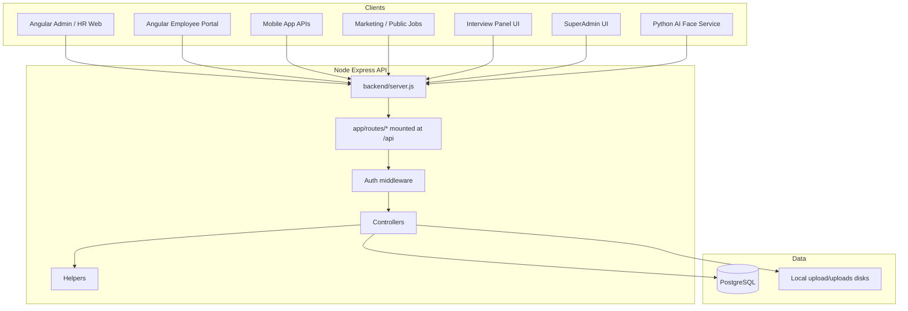
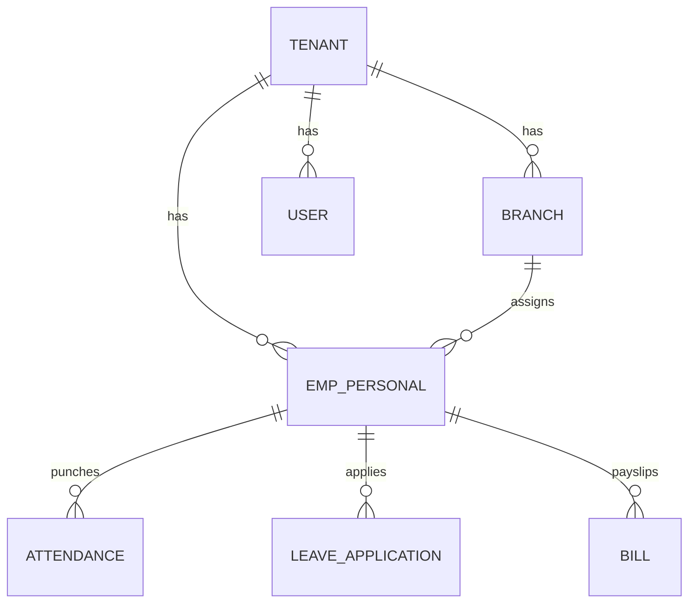

# DOCUMENT 01 — SYSTEM_OVERVIEW

**Verification labels used in this knowledge base:** IMPLEMENTED · PARTIALLY_IMPLEMENTED · DOCUMENTED_ONLY · NOT_FOUND · UNKNOWN · NEEDS_VERIFICATION

---

## 1. What GENS.Ai is

GENS.Ai is a **multi-tenant SaaS Human Resource Management System (HRMS)** for organizations (primarily Indian SMB positioning per `docs/GENS_Feature_Analysis.pdf`). It covers core HR, attendance, leave, payroll, recruitment/ATS, expenses, assets, projects/timesheets, performance, AI face attendance, field location tracking, HR letters/documents, and a public marketing/landing site with subscription plans.

**Evidence:** repository layout (`frontend/`, `backend/`), feature analysis PDF, route modules under `backend/app/routes/`.

**Status:** IMPLEMENTED as a working codebase; operational completeness per tenant is NEEDS_VERIFICATION.

---

## 2. Business purpose

| Purpose | Evidence |
|---|---|
| Centralize employee lifecycle (hire → attend → leave → pay → exit docs) | Controllers under `backend/app/controller/tenant/` |
| Multi-company (tenant) isolation with branches | Models `tenant`, `branch`, `users`, `empPersonal` |
| Self-service for employees (mobile + employee portal) | Routes `app.js`, `employeePortal.js`; frontend `employee-portal/` |
| Recruitment pipeline with ATS scoring | `candidate.js`, `job.js`, `interview.js` |
| Platform operator (superadmin) manages tenants/plans | `superadmin.js`, public Razorpay subscription |

---

## 3. Application architecture

| Layer | Path | Notes |
|---|---|---|
| Frontend | `frontend/` | Angular 19 standalone, lazy routes |
| Backend | `backend/server.js` | Express 5, port `SERVER_PORT` or 9000 |
| ORM | Sequelize 6 | Models in `backend/app/models/` |
| DB | PostgreSQL | `backend/app/connection/connection.js`, schema from `DB_SCHEMA` |
| Static files | `/upload`, `/uploads`, `/attendance/facedata` | Local disk |

---

## 4. Technology stack

| Area | Technology | Source |
|---|---|---|
| Frontend | Angular 19.2, Bootstrap 5, Tailwind 3, RxJS | `frontend/package.json` |
| Backend | Node.js, Express 5 | `backend/package.json`, `server.js` |
| ORM / DB | Sequelize 6, `pg`, PostgreSQL | same |
| Auth | JWT (`jsonwebtoken`), SHA-256 passwords (`crypto-js`) | `middleware/auth.js`, `controller/auth/login.js` |
| Push | Firebase Admin | `backend/app/notification/` |
| Payments | Razorpay | `controller/publicPayment.js`, `lib/planPayment.js` |
| Docs | pdfmake, docx, xlsx | package.json |
| OCR | tesseract.js | `lib/receiptOcr.js` |
| Face AI | External Python service + MediaPipe (frontend) | `controller/tenant/aiFace.js`, frontend face services |

---

## 5. Frontend / backend communication

- Base URL: `environment.apiUrl` (e.g. `.../api/`).
- HTTP: mostly `POST` even for reads (`frontend/src/app/services/*`).
- Interceptor `aut.interceptor.ts` attaches:
  - `Authorization: Bearer <token>`
  - `branchId` header from `localStorage`
- Token contexts: admin `token`, `empPortalToken`, `superadminToken`, `panelToken`.
- Expiry signal: response body `status === 'expired'` → clear storage and redirect login.

**Status:** IMPLEMENTED.

---

## 6. Database architecture

- **Shared database, shared schema, tenant column isolation** (`tenantId` on business tables).
- Many tables also have `branchId`; employees may have `branchIds` (multi-branch).
- Sequelize `sync({ alter: false })` only for a curated subset of newer tables in `server.js`; most tables assumed pre-existing.
- ER sources: `gens_final_er.dbml`, `er_employee_management.dbml`, `er_recruitment.dbml`, `er_superadmin.dbml` (61 tables in merged DBML; **~100 Sequelize model files** — newer modules exceed DBML).

---

## 7. Multi-tenancy

| Aspect | Behaviour | Status |
|---|---|---|
| Tenant key | UUID `tenantId` | IMPLEMENTED |
| Login scoping | Web login requires `companyCode` → active tenant | IMPLEMENTED |
| Query isolation | Controllers manually filter `where: { tenantId }` | PARTIALLY_IMPLEMENTED (no Sequelize global scope / RLS) |
| Subscription / seats | Checked on some create paths; not rechecked every request | PARTIALLY_IMPLEMENTED |
| Geo masters | Country/state/city largely global | IMPLEMENTED |

---

## 8. Branch management

- Model: `backend/app/models/branch.js` — `latitude`, `longitude`, `range` used for geofencing.
- Admin APIs: create/get/update/delete/branch-dd, copy-branch-master-data (`department.js` routes).
- Request branch for Admin comes from **client header** `branchid` — not validated against user’s assigned branches (`middleware/auth.js`).
- Employee AppAdmin uses branch from `empPersonal`.
- Helpers: `normalizeBranchIds`, `resolveBranchScope` in `helper/helper.js`.

**Status:** IMPLEMENTED with isolation caveats.

---

## 9. Authentication (summary)

Four primary guards in `backend/app/middleware/auth.js` plus `PanelUser` in `panelAuth.js`. See `07_AUTHENTICATION_AND_SECURITY.md`.

| Context | Guard | Table |
|---|---|---|
| Admin/HR web | `Admin` | `users` |
| Webcam / AI long token | `WebcamAdmin` | `users.webcamtoken` |
| Platform | `SuperAdmin` | `users` role superadmin |
| Employee mobile/portal | `AppAdmin` | `empPersonal` token/webToken |
| Interview panel | `PanelUser` | `interview_panel_users` |

---

## 10. Main application workflows

| Workflow | Entry | Status |
|---|---|---|
| Company registration | `POST /api/company-register` | IMPLEMENTED |
| Employee create / pending approve | `createEmp`, `RegisterAppEmp`, `approve-all-pending-emp` | IMPLEMENTED |
| Attendance punch | `mark-attendance`, AI internal punch, HR add-attendance | IMPLEMENTED |
| Leave apply/approve | app + admin leave routes | PARTIALLY_IMPLEMENTED (balance timing nuances) |
| Payroll generate | `generate-Salary` | PARTIALLY_IMPLEMENTED (client-trusted amounts) |
| Expense claim | `/expense/my/*` | IMPLEMENTED |
| Recruitment apply → offer | public + admin candidate/interview | PARTIALLY_IMPLEMENTED (no hire→employee auto) |
| Asset allocate/return | `/asset/*` | IMPLEMENTED |
| Timesheet week submit | `/project/my/*` | IMPLEMENTED |
| Performance cycle/review | `/performance/*` | IMPLEMENTED |

Details: `08_WORKFLOW_DOCUMENTATION.md`.

---

## 11. External integrations

| Integration | Purpose | Config / source | Status |
|---|---|---|---|
| SMS gateway (`sms.quaeretech.com`) | OTP | Hardcoded credentials in helper — **security issue** | IMPLEMENTED |
| Firebase FCM | Push notifications | `notification.json` (committed) | IMPLEMENTED |
| Google Maps / Roads | Geocode / snap-to-roads | `GOOGLE_MAP_KEY`, `GOOGLE_MAPS_KEY` | IMPLEMENTED |
| Razorpay | Public plan subscription start | `RAZORPAY_*` | IMPLEMENTED |
| Python AI Face service | Recognition / punch | `AI_FACE_SERVICE_URL`, service key | IMPLEMENTED |
| Resume ATS HTTP API | Score resumes | hardcoded demo URL in candidate controller | IMPLEMENTED |
| Nodemailer | Interview mail / password reset | `MAIL_*` | IMPLEMENTED |
| Tesseract OCR | Expense receipts | `OCR_*` | IMPLEMENTED |

---

## 12. System boundaries

**In scope of this codebase**
- Angular HRMS UI + Node API + Postgres schema/models
- Local file storage for uploads, PDFs, face photos
- Integrations listed above

**Out of scope / not found in-repo**
- Intent Bot Engine PDF referenced by stakeholders: **NOT_FOUND** in repository
- Statutory payroll (PF/ESI/PT/TDS/Form 16) marked as gaps in Feature Analysis PDF
- Automated test suite: package `test` script is a stub
- Cloud object storage (S3 etc.): NOT_FOUND
- Server-side permission middleware matching UI matrix: NOT_FOUND

**Deployment note:** Root `Dockerfile` is inconsistent (expects root `server.js`/`npm install`). Real deploy via `.github/workflows/deploy.yml` (pm2 `gens` / `gens-staging`).

---

## 13. API surface size (verified from routes)

| Metric | Value | Source |
|---|---|---|
| Route files | 40 (incl. empty `api.js` + backup `app_6_10_2026.js`) | `backend/app/routes` |
| Route declarations | 575 | regex inventory |
| Unique method+path (active, excl. backup file uniqueness) | **531** | inventory script |
| Postman requests | 175 | `GENS_API.postman_collection.json` |
| Sequelize model files | ~102 | `backend/app/models` |

Reference claim of “~530 APIs / 38 route files / 19 modules” is **approximately consistent** with this repository (531 unique endpoints; 40 route files including empty/backup).
