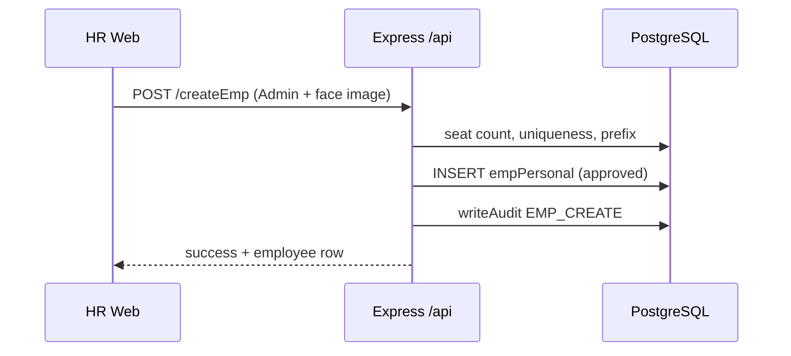
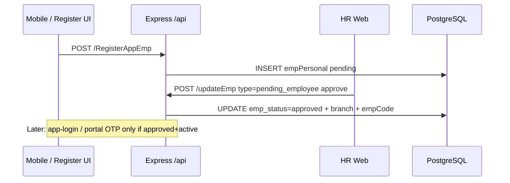
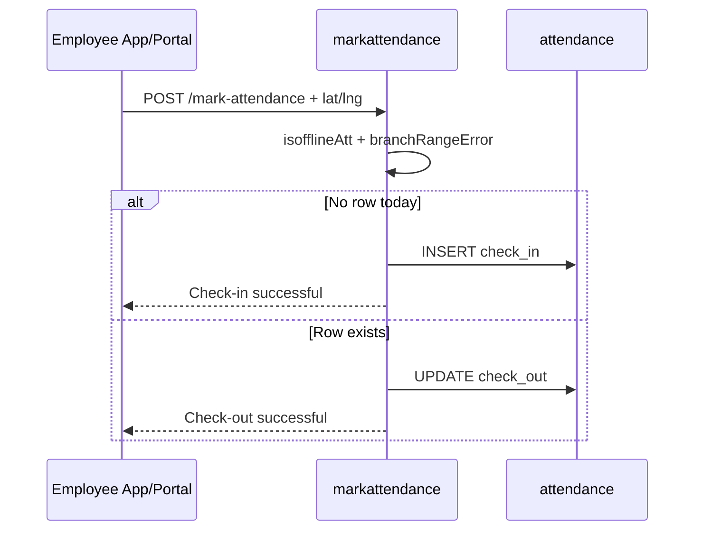
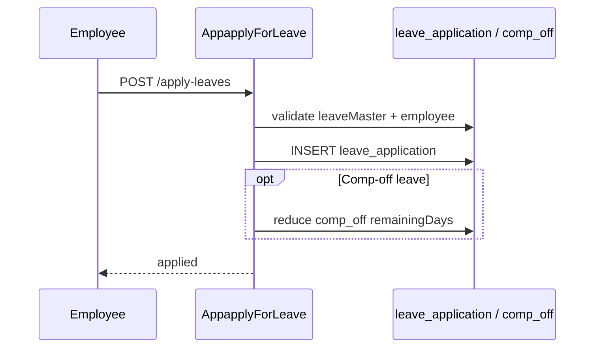
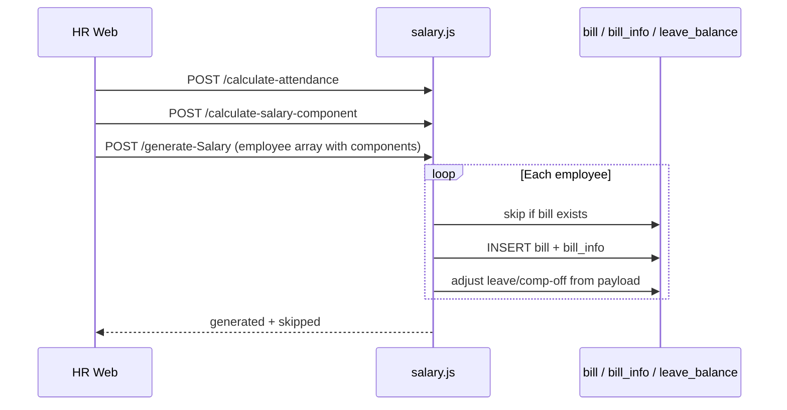
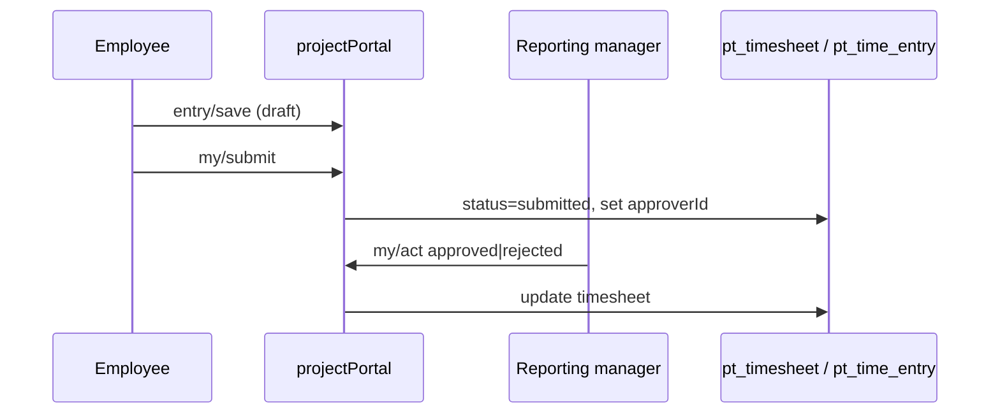
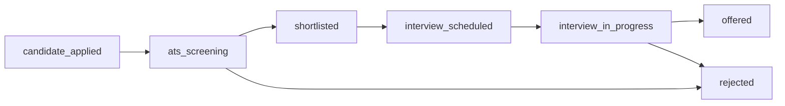
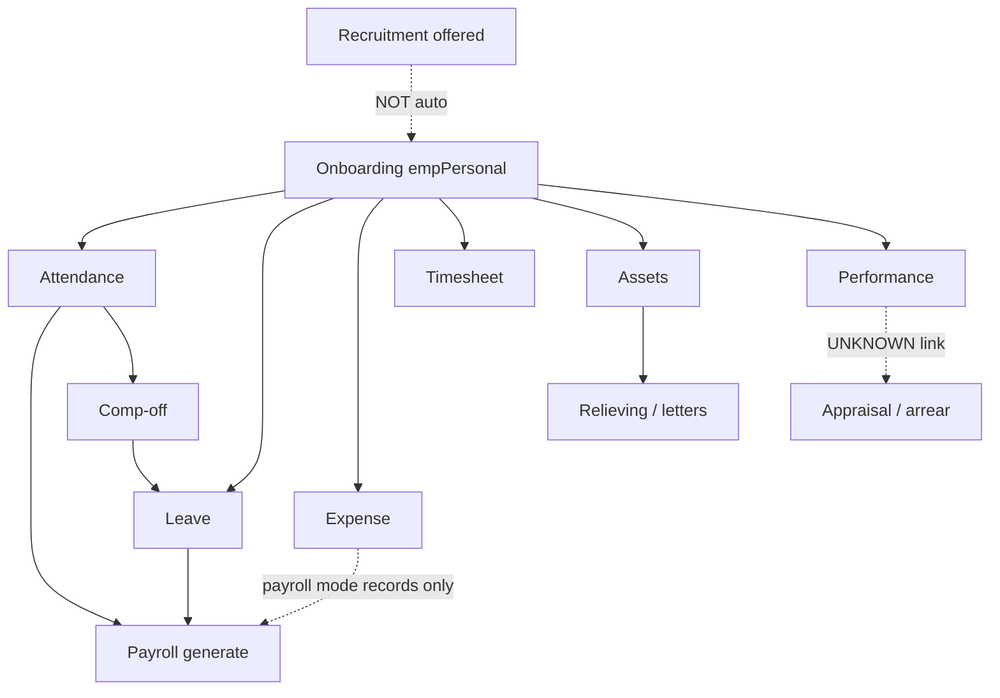

# DOCUMENT 08 — WORKFLOW_DOCUMENTATION

> End-to-end workflows of the **existing** GENS.Ai HRMS, traced from routes → controllers/helpers → database.
> **Scope:** documentation only. No application code was changed.
> **Labels:** `IMPLEMENTED` · `PARTIALLY_IMPLEMENTED` · `DOCUMENTED_ONLY` · `NOT_FOUND` · `UNKNOWN` · `NEEDS_VERIFICATION`
> **Companions:** `API_CATALOG.md`, `BUSINESS_RULES.md`, `COMPLETE_MODULE_CATALOG.md`, `USER_ROLES_AND_PERMISSIONS.md`, `AUTHENTICATION_AND_SECURITY.md`

All API paths below are under `/api` (mounted in `backend/server.js`).

---

## How to read each workflow

| Field | Meaning |
|---|---|
| Starting event | Who/what starts the flow |
| Required inputs | Fields the implementation actually checks |
| API sequence | Registered endpoints in call order |
| Validation | Server-side checks found in code |
| Database changes | Tables written/updated |
| Approval | Who acts, and whether authority is verified |
| Final result | Success outcome |
| Failures | Documented reject paths |
| Status | Verification label |

---

## 1. Employee onboarding (HR create)

| | |
|---|---|
| **Status** | IMPLEMENTED |
| **Starting event** | HR/Admin opens Add Employee and submits form |
| **Required inputs** | `branchId`, first/last name, mobile, email, DOB; optional Aadhaar/PAN/etc. validated when present |
| **API sequence** | `POST /createEmp` (`routes/empPer.js` → `empPersonal.createEmp`) |
| **Validation** | Tenant from `Admin` guard; seat limit vs subscription when seats set; duplicate mobile/email/code; pending registration blocks create; emp code auto-generated via prefix if blank |
| **Database changes** | Insert `empPersonal` with `emp_status='approved'`, `status='active'` (or body status); audit `EMP_CREATE` |
| **Approval** | None (direct create) |
| **Final result** | Active employee usable for attendance/leave/login once credentials/OTP path used |
| **Failures** | Missing branch; seat limit; duplicate; `PREFIX_MISSING` / `EMPCODE_GEN_FAILED`; pending duplicate mobile/email |



---

## 2. Employee self-registration → pending approval

| | |
|---|---|
| **Status** | IMPLEMENTED |
| **Starting event** | Candidate/employee submits app registration with company code |
| **Required inputs** | first/last name, mobile, email, DOB, gender, `companyCode`, photo + `photoHash` |
| **API sequence** | Optional `POST /check-tenant` → `POST /RegisterAppEmp` → HR `POST /get-emp-list` / pending UI → `POST /updateEmp` (`type=pending_employee`) **or** `POST /approve-all-pending-emp` |
| **Validation** | Company code → tenant; age ≥ 18; photo hash unique per tenant; mobile/email not already active |
| **Database changes** | Insert `empPersonal` with default `emp_status='pending'`; on approve → `emp_status='approved'`, assign `branchId`/`branchIds`/empCode; on reject → `emp_status='rejected'` |
| **Approval** | HR/Admin |
| **Final result** | Only `status=active` **and** `emp_status=approved` can use `app-login` / portal OTP |
| **Failures** | No company; validation errors; duplicate photo/mobile/email; approve skipped if mobile already approved in branch |
| **Known gaps** | Seat limit **not** checked on approve / bulk approve (`BUSINESS_RULES.md`) |



---

## 3. Employee profile update (self)

| | |
|---|---|
| **Status** | IMPLEMENTED (fields NEEDS_VERIFICATION per call) |
| **Starting event** | Employee edits profile in app/portal |
| **Required inputs** | Authenticated `AppAdmin` identity; body fields for update |
| **API sequence** | `GET /get-Emp-Details` → `POST /update-app-emp` and/or `POST /uploadEmpImage` / bank/document App* endpoints |
| **Validation** | Token must match `empPersonal.token` or `webToken` |
| **Database changes** | Update `empPersonal` / related bank/document rows |
| **Approval** | None for self-update path |
| **Final result** | Updated profile |
| **Failures** | Expired token; user not found |

---

## 4. Attendance punching (app / portal)

| | |
|---|---|
| **Status** | IMPLEMENTED (with known date TZ risk) |
| **Starting event** | Employee marks attendance |
| **Required inputs** | `AppAdmin` session; typically `latitude`/`longitude` in body; optional image upload; `isofflineAtt` must be true on employee |
| **API sequence** | `POST /mark-attendance` (`routes/app.js` → `appApi.markattendance`) |
| **Validation** | Active employee; web attendance enabled (`isofflineAtt`); geofence via branch `latitude`/`longitude`/`range` unless location flags relax check (`branchRangeError`) |
| **Database changes** | First punch of day → INSERT `attendance` with `check_in_time`; later punch → UPDATE `check_out_time` |
| **Approval** | None |
| **Final result** | Check-in or check-out success message |
| **Failures** | Web attendance disabled; out of branch range; employee not found |
| **Related paths** | HR `POST /add-attendance` uses shared `helper/attendancePunch.recordAttendancePunch`; AI face `POST /ai-face/internal/punch` also uses that helper |
| **Caveat** | `markattendance` derives `date` via `toISOString()` (UTC) while datetime string uses local components — punches near midnight IST may land on wrong date (`BUSINESS_RULES.md` R-X-04) |



---

## 5. Attendance regularization

| | |
|---|---|
| **Status** | PARTIALLY_IMPLEMENTED |
| **Starting event** | Employee requests correction of in/out times |
| **Required inputs** | `attendanceDate`, `reason`, and at least one of `inTimeRequested` / `outTimeRequested`; `branchId` from session |
| **API sequence** | `POST /create-regularization` → lists: `/regularization-list`, `/pending-regularize-list` → `POST /update-status` |
| **Validation** | No future date; within **2 working days** (Sat/Sun skipped in window counter); required fields |
| **Database changes** | INSERT/UPDATE `attendance_regularization`; on approve, attendance row may be created/updated (controller continues after line ~5510 — confirm per status) |
| **Approval** | Approver acts via `update-status`; **manager identity not strictly verified** (PARTIALLY) |
| **Final result** | Request approved/rejected; attendance may reflect requested times |
| **Failures** | Missing branch/fields; future date; outside 2 working-day window |
| **Gaps** | Status enum not tightly validated; 2-day calendar check is commented out in favour of working-day rule |

---

## 6. Leave application (employee)

| | |
|---|---|
| **Status** | IMPLEMENTED |
| **Starting event** | Employee applies leave from app/portal |
| **Required inputs** | `employeeId`, `leaveTypeId`, `fromDate`/`toDate`, `reason`; optional `duration_type` / `to_duration_type`; optional `compOffId` |
| **API sequence** | `POST /get-app-leave-type-dd` / leave list → `POST /apply-leaves` (`AppapplyForLeave`) |
| **Validation** | Leave type exists for tenant+branch; gender restriction; `applyBeforeDays` advance rule; branch required |
| **Database changes** | INSERT `leave_application`; for comp-off type may decrement `comp_off.remainingDays` at apply time |
| **Approval** | Pending until manager/HR acts |
| **Final result** | Leave row in pending (or auto paths for some comp-off admin flows) |
| **Failures** | Invalid leave type; gender mismatch; applied too late vs `applyBeforeDays` |
| **Risk** | Comp-off may also be deducted again at salary generation — possible double consumption (`BUSINESS_RULES.md`) |



---

## 7. Leave approval / rejection

| | |
|---|---|
| **Status** | PARTIALLY_IMPLEMENTED |
| **Starting event** | Manager/director/HR acts on pending leave |
| **Required inputs** | Leave id + new status (app: `POST /update-apply-leaves-status`; admin: `POST /update-apply-leave-status`) |
| **API sequence** | `POST /pending-leave-list` (or team/director lists) → `POST /update-apply-leaves-status` |
| **Validation** | Role-string checks in `appApi` for who may approve; web admin path exists separately |
| **Database changes** | UPDATE `leave_application.status` / related fields; **balance often not adjusted until payroll** |
| **Approval** | Manager / team lead / director / HR depending on path; escalations UNKNOWN |
| **Final result** | Approved / rejected / unpaid / LOP variants as used by callers |
| **Failures** | Unauthorized role messages; missing ids |
| **Gaps** | Web status updates may accept unvalidated status strings; balance timing deferred to `generateSalary` |

---

## 8. Payroll generation

| | |
|---|---|
| **Status** | PARTIALLY_IMPLEMENTED |
| **Starting event** | HR opens Generate Salary, previews, then submits |
| **Required inputs** | `branchid` header; body = array of employees with `employeeId`, `year`, `month`, `components`, leave/sandwich arrays, etc. |
| **API sequence** | Typically `POST /calculate-attendance` → `POST /calculate-salary-component` → `POST /generate-Salary` → list via `POST /generate-Salary-list` |
| **Validation** | Branch required; skip if bill already exists for employee/month/year/branch |
| **Database changes** | INSERT `bill` + `bill_info`; deduct leave balances / comp-off usage maps from request payload; audit `SALARY_GENERATE` |
| **Approval** | No multi-level payroll approval workflow found (NOT_FOUND) |
| **Final result** | Payslip/bill available; skipped list for already-generated |
| **Failures** | Missing fields; already generated |
| **Critical risk** | `generateSalary` **trusts client-computed component amounts** rather than fully recomputing server-side |
| **Revert** | `POST /revert-Salary` deletes/reverts bill; **does not restore comp-off usage** |



---

## 9. Payslip retrieval (employee)

| | |
|---|---|
| **Status** | IMPLEMENTED |
| **Starting event** | Employee opens salary/payslip in app/portal |
| **Required inputs** | `AppAdmin` session; year/month (as required by controller body — NEEDS_VERIFICATION exact fields) |
| **API sequence** | `POST /get-app-bill-details` → optional `POST /print-bill` |
| **Validation** | Token identity; tenant/employee scoping expected in controller |
| **Database changes** | Read `bill` / `bill_info` (and print artifacts) |
| **Approval** | None |
| **Final result** | Bill details / printable payslip |
| **Failures** | No bill for period; expired token |

---

## 10. Expense submission (workflow claims)

| | |
|---|---|
| **Status** | IMPLEMENTED |
| **Starting event** | Employee submits expense claim |
| **Required inputs** | Title, line items (category, date, amount, …); optional receipt via `/expense/my/receipt` |
| **API sequence** | `POST /expense/my/categories` → optional `/expense/my/receipt` → `/expense/my/validate` → `/expense/my/submit` → track via `/expense/my/claims` |
| **Validation** | Category limits (`perClaimLimit`, `monthlyLimit`); `limitAction` block vs flag; receipt age/OCR flags via `helper/expense.js` |
| **Database changes** | Rows in `expense_claim`, `expense_item`, `expense_receipt`, `expense_approval` (+ linkage to reimbursement header pattern used by module) |
| **Approval** | Multi-level: default `manager` → `finance`; rules may add levels; flagged may require `hr` |
| **Final result** | Claim pending at level 1 |
| **Failures** | Limit block; validation errors; inactive claim states |

```mermaid
sequenceDiagram
  participant Emp as Employee
  participant API as expensePortal
  participant Appr as Manager/HR/Finance
  participant DB as expense_*
  Emp->>API: POST /expense/my/submit
  API->>DB: validate limits + create claim + levels
  Appr->>API: POST /expense/my/act
  API->>DB: advance level or reject
  Note over Appr,DB: Final level approve → approved; then mark-paid
```

---

## 11. Expense approval / payment

| | |
|---|---|
| **Status** | IMPLEMENTED |
| **Starting event** | Approver acts; finance marks paid |
| **API sequence** | `POST /expense/my/approvals` → `POST /expense/my/act` → `POST /expense/my/mark-paid` (or HR `POST /expense/claim/act`, `/expense/claim/mark-paid`) |
| **Validation** | Rejection requires reason; payment needs mode, reference, date; payroll month/year when mode requires |
| **Database changes** | Approval rows; claim status → approved/rejected/paid |
| **Approval** | Level must match actor type |
| **Final result** | Paid claim |
| **Gaps** | “Payroll” payment mode records month/year but **no automatic payroll deduction link found** |

---

## 12. Legacy reimbursement (parallel path)

| | |
|---|---|
| **Status** | PARTIALLY_IMPLEMENTED |
| **Starting event** | Employee/HR uses older reimbursement APIs |
| **API sequence** | App: `POST /add-app-reimbursement` → `GET /reimbursement-list` → `POST /update-app-reimbursement-status`; Admin: `/add-reimbursement`, `/update-reimbursement-status`, … |
| **Validation** | Status updates less strict; workflow expense claims blocked from legacy status update when `isWorkflowClaim` |
| **Database changes** | `reimbursement`, `reimbursement_file` |
| **Note** | Coexists with expense module — AI assistant must not confuse the two |

---

## 13. Asset allocation

| | |
|---|---|
| **Status** | IMPLEMENTED |
| **Starting event** | HR allocates available asset to active employee |
| **Required inputs** | Asset id, employee id, allocation date; condition/notes per `helper/assets.js` |
| **API sequence** | `POST /asset/register` (if new) → `POST /asset/allocate` → employee `POST /asset/my/acknowledge` |
| **Validation** | Asset status must be `available`; employee active; dates consistent; serial uniqueness at register |
| **Database changes** | UPDATE `as_asset.status=allocated`; INSERT `as_allocation` (`ackStatus` pending or not_required); `as_event` |
| **Approval** | Acknowledgement by employee (ack/dispute) |
| **Final result** | Asset with employee; ack recorded |
| **Failures** | Wrong status; inactive employee; validation errors |

---

## 14. Asset return / clearance

| | |
|---|---|
| **Status** | IMPLEMENTED |
| **Starting event** | Employee requests return and/or HR receives return; exit clearance check |
| **API sequence** | `POST /asset/my/request-return` → HR `POST /asset/return` → clearance `POST /asset/clearance` (override exists) |
| **Validation** | Condition required unless lost; return date rules; `recoveryAmount` ≥ 0 |
| **Database changes** | Close allocation; asset → `available` or `lost`; optional recovery amount stored (not auto-payroll) |
| **Final result** | Asset returned; employee clearance when no active allocations |
| **Side effect** | Relieving letter generation can be blocked by uncleared assets (`letter_data` controller) |

---

## 15. Timesheet submission

| | |
|---|---|
| **Status** | IMPLEMENTED |
| **Starting event** | Employee logs hours for a Monday-start week |
| **Required inputs** | Project allocation active; entry date/hours rules in `helper/projectTime.js` |
| **API sequence** | `POST /project/my/week` → `/project/my/entry/save` (timer optional start/stop) → `/project/my/submit` → approver `/project/my/approvals` → `/project/my/act` |
| **Validation** | Hours >0 ≤24; day total ≤24; no future dates; project active; allocation exists; timer stopped before submit; at least some hours |
| **Database changes** | `pt_time_entry`, `pt_timesheet` status `draft` → `submitted` → `approved`/`rejected` |
| **Approval** | Approver = employee `reportingPersonId` (UI shows HR if none); rejection needs comment |
| **Final result** | Approved week |
| **Gaps** | Reconciliation flags vs attendance are informational (do not block submit); no payroll link found |



---

## 16. Recruitment (apply → interview → offer)

| | |
|---|---|
| **Status** | PARTIALLY_IMPLEMENTED |
| **Starting event** | Candidate opens public job link |
| **Required inputs** | Name, email, phone, resume; job must be `open` |
| **API sequence** | `POST /public-job-posting` → `/check-duplicate-application` → `/submit-application` → ATS external call → HR `/admin-pipeline` / `/update-stage` / `/save-ats-score` → `/assign-interviewer` / `/save-interview-schedule` → feedback (`/save-interview-feedback` or panel `/panel-save-feedback`) → offer letter APIs under `job.js` |
| **Validation** | Duplicate application 409; email format; job open |
| **Database changes** | `candidates`, `applications`, `candidate_ats_scores`, interview round/feedback tables, `offer_letters` |
| **Approval** | Interview recommendations; stage transitions often free-string (weak enforcement) |
| **Final result** | Stage may reach `offered`; PDF offer generated |
| **Gaps** | No automatic candidate→employee conversion found; HR vs panel feedback rules differ on when stage becomes `offered` |



---

## 17. Performance review cycle

| | |
|---|---|
| **Status** | IMPLEMENTED (cycle stage enum completeness NEEDS_VERIFICATION) |
| **Starting event** | HR creates/launches cycle; employee/manager complete reviews |
| **API sequence (HR)** | `/performance/cycle/save` → `/performance/cycle/launch` → review list/detail → approve/close |
| **API sequence (employee/manager)** | `/performance/my/reviews` → goal save/progress → `/performance/my/lock-goals` → `/performance/my/self-review` → manager `/performance/my/manager-review` → feedback request/submit → `/performance/my/approve` |
| **Validation** | Goal/KR rules; ratings 1–5; potential 1–3; rejection comments; weighted final rating in `helper/performance.js` |
| **Database changes** | `pm_cycle`, `pm_review`, `pm_goal`, `pm_key_result`, `pm_feedback`, `pm_review_approval` |
| **Approval** | Multi-level after manager review (`in_approval` → `approved`) |
| **Final result** | Approved review with `finalRating` / band |
| **Gaps** | Link from performance rating → payroll/appraisal raise is separate module (`appraisal.js`) — cross-link UNKNOWN |

---

## 18. HR document / letter generation

| | |
|---|---|
| **Status** | IMPLEMENTED |
| **Starting event** | HR builds template or generates letter for employee |
| **API sequence** | Master: `/hr-template-*` (variables, create, preview, save-generated); legacy letters: `/save-letter-data`, `/generate-letter-pdf`, offer/appointment/NDA flows in employee UI calling letter/job endpoints |
| **Validation** | Template variables filled from employee/salary/company snapshot; relieving may check asset clearance |
| **Database changes** | `document_templates`, `generated_documents`, `letter_data`, file under `uploads/pdfs` |
| **Final result** | Preview HTML / saved generated doc / PDF |
| **Spec** | Also described in `docs/hr-document-template-spec.md` |

---

## 19. Company registration (tenant bootstrap)

| | |
|---|---|
| **Status** | IMPLEMENTED |
| **Starting event** | Public company sign-up |
| **API sequence** | `POST /company-register` (logo upload) → admin `POST /login` |
| **Database changes** | `tenant` + admin `users` row (`role=admin`); branch/subscription may be incomplete at register (see module catalog) |
| **Final result** | Tenant with company code for subsequent logins |

---

## 20. AI face attendance punch (service-driven)

| | |
|---|---|
| **Status** | IMPLEMENTED |
| **Starting event** | Python face service recognizes enrolled face |
| **API sequence** | Enrolment `/ai-face/enroll/:employeeId` → cameras start → service callback `POST /ai-face/internal/punch` (service key) → `recordAttendancePunch` |
| **Database changes** | `ai_recognition_logs`, `attendance` via shared punch helper |
| **Failures** | Bad service key; employee/branch missing; inactive enrolment |

---

## Cross-workflow dependency map



---

## Failure patterns common to many workflows

| Pattern | Behaviour | Evidence |
|---|---|---|
| Auth expiry | HTTP 200, `status: "expired"` | middleware + interceptor |
| Business reject | Often HTTP 200, `status: false` + message | `Helper.response` |
| Missing branch | `"branchId is required!"` on many AppAdmin/Admin writes | multiple controllers |
| Tenant filter gaps | Some updates by id without tenantId | noted in `BUSINESS_RULES.md` R-X-01 |
| Backup routes | `app_6_10_2026.js` mounted but shadowed — do not document as alternate live flow | `server.js` + catalog |

---

## Workflow coverage checklist

| Workflow | Documented | Runtime tested in this investigation |
|---|---|---|
| HR employee create | Yes | No — NEEDS_VERIFICATION |
| Self-register + approve | Yes | No — NEEDS_VERIFICATION |
| Profile update | Yes (light) | No |
| Attendance punch | Yes | No |
| Regularization | Yes | No |
| Leave apply/approve | Yes | No |
| Payroll generate / payslip | Yes | No |
| Expense submit/approve | Yes | No |
| Legacy reimbursement | Yes (light) | No |
| Asset allocate/return | Yes | No |
| Timesheet | Yes | No |
| Recruitment | Yes | No |
| Performance | Yes | No |
| Document generation | Yes | No |
| AI face punch | Yes | No |
| Full F&F / exit offboarding | Partial only | Soft exit fields exist; end-to-end workflow UNKNOWN |

---

## How to update

1. When a controller changes, update the matching section and status label.
2. After a successful Postman/runtime test, change `NEEDS_VERIFICATION` → note “runtime verified on \<date\>”.
3. Keep API paths synchronized with `API_CATALOG.md` / `_gen_api_catalog.js`.
